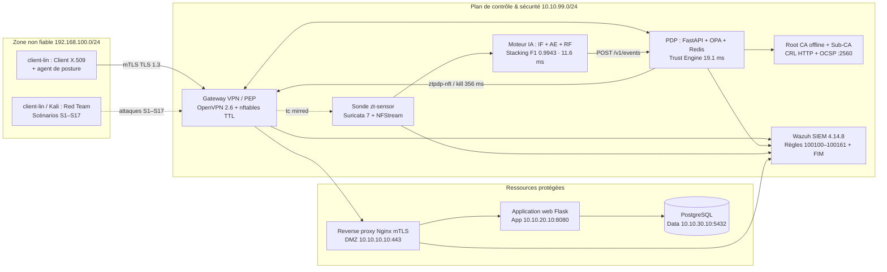

# 🛡️ ZT-PKI-AI — Architecture Zero Trust (PKI + VPN) avec détection d'anomalies par IA

> **Conception et mise en œuvre d'une architecture Zero Trust basée sur PKI et VPN avec détection intelligente des anomalies réseau par Intelligence Artificielle**

---

## 1. Résumé

Ce projet construit, dans un laboratoire virtualisé, une **infrastructure Zero Trust complète et fonctionnelle** :

1. **Identité forte** : une PKI à deux niveaux (Root CA hors-ligne + Issuing CA) délivre des certificats X.509 courts aux utilisateurs, machines et services.
2. **Accès conditionnel** : un VPN (OpenVPN, mTLS + TLS 1.3) ne donne accès qu'à une *surface minimale* ; chaque connexion est évaluée par un **moteur de décision (PDP)** avant d'ouvrir le moindre flux.
3. **Micro-segmentation** : le pare-feu (nftables) applique le principe *deny-by-default* ; les autorisations sont **dynamiques, à durée limitée (TTL)** et basées sur l'identité, pas sur l'IP.
4. **Vérification continue par IA** : les flux réseau sont analysés en temps réel (Isolation Forest, Autoencodeur, Random Forest, analyse comportementale par entité). Le **score d'anomalie alimente un score de confiance** qui peut **réduire les droits, mettre en quarantaine ou révoquer le certificat** automatiquement.
5. **Observabilité** : Suricata + Wazuh centralisent logs, alertes et décisions Zero Trust.

**Idée centrale** : *ne jamais faire confiance, toujours vérifier — et vérifier en continu grâce à l'IA, pas seulement à la connexion.*

## 2. Pourquoi ce projet est « réel » et techniquement solide

| Dimension | Ce qui est réellement mis en œuvre |
|---|---|
| Cryptographie / PKI | Root offline, Intermediate, profils de certificats, CRL, OCSP, rotation, révocation |
| Réseau | Segmentation multi-zones, routage/pare-feu nftables dynamique, tunnel TLS 1.3 |
| Architecture | Modèle NIST SP 800-207 : PE / PA / PEP, plan de contrôle vs plan de données |
| Développement | PDP en Python (FastAPI) + OPA (Rego), hooks OpenVPN, agent de posture |
| Data science | Pipeline complet : extraction de features, entraînement, évaluation, dérive, explicabilité |
| SecOps | IDS, SIEM, règles de corrélation, réponse automatisée (SOAR-like) |
| Validation | Scénarios d'attaque mappés MITRE ATT&CK, métriques mesurables (TTD, TTQ, FPR, overhead) |

## 3. Vue d'ensemble



## 4. Stack technique

`OpenSSL 3 (ECDSA P-384 / P-256)` · `OpenVPN 2.6 (TLS 1.3 + tls-crypt)` · `nftables (sets dynamiques à TTL)` · `Suricata 7 (46k règles)` · `NFStream (47 features)` · `Python 3.11+` · `FastAPI` · `OPA (Rego)` · `Redis` · `scikit-learn` · `PyTorch 2.11 (CUDA 12.8)` · `SHAP` · `Wazuh 4.14.8` · `Docker Compose` · `VirtualBox 7.1 (virtio)` · `Vagrant` · `Ansible` · `Debian 12 / Ubuntu 22.04`

## 5. Structure du dépôt

```text
sec/
├── README.md
├── RULES-OF-ENGAGEMENT.md  # cadre d'engagement et périmètre d'isolation des tests
├── TODO.md                 # suivi d'avancement par jalon (M1–M8)
├── TODO_REDTEAM.md         # runbook d'exécution des scénarios Red Team & A/B/C/D
├── docs/
│   ├── 01-cadrage-et-modele-de-menaces.md
│   ├── 02-architecture.md
│   ├── 03-environnement-lab.md
│   ├── 04-pki.md
│   ├── 05-vpn.md
│   ├── 06-zero-trust-pdp-pep.md
│   ├── 07-detection-ia.md
│   ├── 08-supervision-siem.md
│   ├── 09-tests-et-scenarios.md
│   ├── 10-planning-livrables.md
│   └── 12-machines.md
├── pki/                    # configs OpenSSL (Root P-384 offline + Sub-CA), CRL HTTP, OCSP
├── vpn/                    # server.conf, profils clients .ovpn, hooks Python fail-closed
├── firewall/               # nftables.conf (deny-by-default + sets TTL), helpers ztpdp-nft/ssh
├── pdp/                    # API FastAPI, Trust Engine, politiques OPA/Rego, cache Redis, tests
├── ai/                     # schéma 47 features, entraînement GPU, registre SHA-256, inférence live
├── sensor/                 # miroir réseau tc mirred, règles locales Suricata
├── siem/                   # règles de corrélation Wazuh (100100–100161) et dashboards
├── apps/                   # reverse proxy Nginx mTLS, app web Flask, PostgreSQL, agent de posture
├── tests/                  # fiches S01–S17, run-m2.sh, run-redteam.sh, abcd/, perf/, reports/
└── infra/                  # Vagrantfile (10 VMs), Ansible (site.yml + 13 rôles), docker-compose, Makefile
```

## 6. Index de la documentation

| # | Document | Contenu |
|---|---|---|
| 01 | [Cadrage & menaces](docs/01-cadrage-et-modele-de-menaces.md) | Problématique, objectifs, hypothèses H1–H4, STRIDE |
| 02 | [Architecture](docs/02-architecture.md) | Composants, flux, décisions d'architecture NIST SP 800-207 |
| 03 | [Environnement](docs/03-environnement-lab.md) | VMs, réseaux internes, plan d'adressage, durcissement |
| 04 | [PKI](docs/04-pki.md) | Hiérarchie 2 niveaux, profils X.509, cérémonies, CRL & OCSP |
| 05 | [VPN](docs/05-vpn.md) | Configuration OpenVPN 2.6, `tls-crypt`, hooks fail-closed |
| 06 | [Zero Trust PDP/PEP](docs/06-zero-trust-pdp-pep.md) | Politique Rego, Trust Score, `nftables` dynamique à TTL |
| 07 | [Détection IA](docs/07-detection-ia.md) | Schéma 47 features, IF/AE/RF + Stacking, SHAP, registre signé |
| 08 | [Supervision](docs/08-supervision-siem.md) | Suricata 7, Wazuh 4.14.8, FIM, règles de corrélation |
| 09 | [Tests & Scénarios](docs/09-tests-et-scenarios.md) | Scénarios S1–S17 mappés MITRE ATT&CK, protocole A/B/C/D |
| 10 | [Planning & Livrables](docs/10-planning-livrables.md) | Roadmap, jalons M1–M8, scénario de démonstration |
| 12 | [Machines du lab](docs/12-machines.md) | Rôle détaillé, ressources et dimensionnement des 10 VMs + hôte GPU |

## 7. Critères de réussite (KPI) & Résultats mesurés

| Indicateur | Cible | Résultat mesuré | Référence |
|---|---|---|---|
| Connexion sans certificat valide (S1, S2, S4) | 100 % refusée | **100 % refusée** | `tests/evidence/s01..s04/` |
| Certificat révoqué (S3) | Refusé en < 60 s | **Refusé en < 60 s** (CRL + révocation PDP immédiate) | `tests/evidence/s03_revoked/` |
| Panne du PDP (S14 — Fail-Closed) | 0 accès accordé | **100 % bloqué** (`PDP_ENFORCE=1`) | `tests/evidence/s14_pdp_down/` |
| Détection IA (F1, test split CIC-IDS2017 dédupliqué) | ≥ 0,95 | **F1 = 0,9943** (ROC-AUC 0,9999) | [`ai/reports/metrics.md`](ai/reports/metrics.md) |
| Taux de faux positifs IA (FPR) | ≤ 2 % | **0,16 %** (11,6 ms/flux sur CPU) | [`ai/reports/metrics.md`](ai/reports/metrics.md) |
| Latence de décision PDP (`/v1/authenticate`) | ≤ 500 ms | **19,1 ms** (médiane) | [`tests/reports/perf.md`](tests/reports/perf.md) |
| Boucle fermée IA → PDP → PEP (TTQ) | ≤ 15 s | **356 ms** (réaction PDP + enforcement `nftables`) | [`tests/reports/perf.md`](tests/reports/perf.md) |
| Surcharge des contrôles ZT (B/C/D vs A, même chemin) | ≤ 15 % | **≤ 6,8 %** | [`tests/reports/results.md`](tests/reports/results.md) |
| Surface exposée depuis un tunnel employé (A vs B/C/D) | 0 violation ZT | **A : 5 violations (7/7) → B/C/D : 0 violation (2/7)** | [`tests/reports/results.md`](tests/reports/results.md) |

## 8. Démarrage rapide & Commandes utiles

```bash
# 1. Déployer et provisionner le laboratoire (Vagrant + Ansible)
make -C infra up
make -C infra mgmt-host              # configure l'IP 10.10.99.2 sur l'hôte (moteur IA)
make -C infra vpn                    # synchronise la PKI, déploie zt-gw et client-lin
make -C infra vpn-check              # vérifie les contrôles M2/M3 (9/9 PASS)

# 2. Exécuter les tests unitaires (PDP + IA)
PYTHONDONTWRITEBYTECODE=1 .venv/bin/pytest ai/tests
PYTHONDONTWRITEBYTECODE=1 PYTHONPATH=pdp python3 -m pytest pdp/tests

# 3. Lancer les scénarios d'attaque Red Team depuis client-lin (S1–S17)
bash tests/run-m2.sh                 # S1–S6, S13, S14 (attaquant externe / passerelle)
bash tests/run-redteam.sh            # S7–S12, S15–S17 (post-connexion, posture, IA, FIM)

# 4. Évaluation comparative A / B / C / D et génération des rapports/graphiques
bash tests/abcd/run-all.sh && bash tests/abcd/attack-abcd.sh
bash tests/perf/perf.sh && bash tests/perf/perf-abcd.sh
```

## 9. ⚠️ Éthique et légalité

Toutes les attaques sont réalisées **uniquement dans le laboratoire isolé** (réseaux host-only/internes, sans accès Internet pour les VMs d'attaque). Aucun outil offensif ne doit être utilisé hors de ce périmètre.
