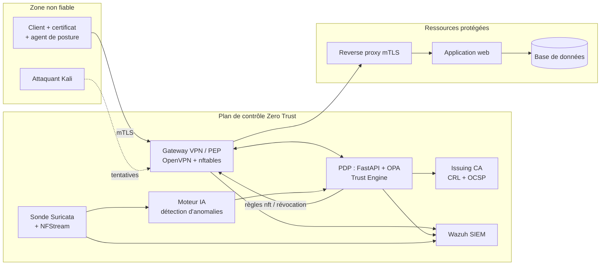

# 🛡️ ZT-PKI-AI — Architecture Zero Trust (PKI + VPN) avec détection d'anomalies par IA

> **Conception et mise en œuvre d'une architecture Zero Trust basée sur PKI et VPN avec détection intelligente des anomalies réseau par Intelligence Artificielle**

---

## 1. Résumé

Ce projet construit, dans un laboratoire virtualisé, une **infrastructure Zero Trust complète et fonctionnelle** :

1. **Identité forte** : une PKI à deux niveaux (Root CA hors-ligne + Issuing CA) délivre des certificats X.509 courts aux utilisateurs, machines et services.
2. **Accès conditionnel** : un VPN (OpenVPN, mTLS + TLS 1.3) ne donne accès qu'à une *surface minimale* ; chaque connexion est évaluée par un **moteur de décision (PDP)** avant d'ouvrir le moindre flux.
3. **Micro-segmentation** : le pare-feu (nftables) applique le principe *deny-by-default* ; les autorisations sont **dynamiques, à durée limitée (TTL)** et basées sur l'identité, pas sur l'IP.
4. **Vérification continue par IA** : les flux réseau sont analysés en temps réel (Isolation Forest, Autoencodeur, Random Forest, analyse comportementale par entité). Le **score d'anomalie alimente un score de confiance** qui peut **réduire les droits, mettre en quarantaine ou révoquer le certificat** automatiquement.
5. **Observabilité** : Suricata + Wazuh centralisent logs, alertes et décisions Zero Trust.

**Idée centrale** : *ne jamais faire confiance, toujours vérifier — et vérifier en continu grâce à l'IA, pas seulement à la connexion.*

## 2. Pourquoi ce projet est « réel » et techniquement solide

| Dimension | Ce qui est réellement mis en œuvre |
|---|---|
| Cryptographie / PKI | Root offline, Intermediate, profils de certificats, CRL, OCSP, rotation, révocation |
| Réseau | Segmentation multi-zones, routage/pare-feu nftables dynamique, tunnel TLS 1.3 |
| Architecture | Modèle NIST SP 800-207 : PE / PA / PEP, plan de contrôle vs plan de données |
| Développement | PDP en Python (FastAPI) + OPA (Rego), hooks OpenVPN, agent de posture |
| Data science | Pipeline complet : extraction de features, entraînement, évaluation, dérive, explicabilité |
| SecOps | IDS, SIEM, règles de corrélation, réponse automatisée (SOAR-like) |
| Validation | Scénarios d'attaque mappés MITRE ATT&CK, métriques mesurables (TTD, TTQ, FPR, overhead) |

## 3. Vue d'ensemble



## 4. Stack technique

`OpenSSL 3` · `OpenVPN 2.6` · `nftables` · `Suricata 7` · `NFStream` · `Python 3.11` · `FastAPI` · `OPA (Rego)` · `Redis` · `scikit-learn` · `PyTorch` · `SHAP` · `Wazuh 4.x` · `Docker Compose` · `Proxmox / VirtualBox / VMware` · `Kali Linux` · `Debian 12`

## 5. Structure du dépôt

```
zt-project/
├── README.md
├── docs/
│   ├── 01-cadrage-et-modele-de-menaces.md
│   ├── 02-architecture.md
│   ├── 03-environnement-lab.md
│   ├── 04-pki.md
│   ├── 05-vpn.md
│   ├── 06-zero-trust-pdp-pep.md
│   ├── 07-detection-ia.md
│   ├── 08-supervision-siem.md
│   ├── 09-tests-et-scenarios.md
│   └── 10-planning-livrables.md
├── pki/            # configs openssl, scripts d'émission/révocation
├── vpn/            # server.conf, client.ovpn, hooks
├── firewall/       # nftables.conf, scripts de mise à jour dynamique
├── pdp/            # API FastAPI, policies Rego, moteur de score
├── ai/             # extraction, entraînement, inférence, notebooks
├── sensor/         # Suricata, NFStream, mirroring
├── siem/           # décodeurs/règles Wazuh, dashboards
├── apps/           # reverse proxy, app web, BD de démonstration
├── tests/          # scénarios d'attaque, automatisation, rapports
└── infra/          # docker-compose, Vagrant/Ansible, requirements.txt
```

## 6. Index de la documentation

| # | Document | Contenu |
|---|---|---|
| 01 | [Cadrage & menaces](docs/01-cadrage-et-modele-de-menaces.md) | Problématique, objectifs, exigences, STRIDE |
| 02 | [Architecture](docs/02-architecture.md) | Composants, flux, décisions d'architecture |
| 03 | [Environnement](docs/03-environnement-lab.md) | VMs, réseaux, plan d'adressage, installation |
| 04 | [PKI](docs/04-pki.md) | Hiérarchie, profils, commandes, révocation |
| 05 | [VPN](docs/05-vpn.md) | Configuration OpenVPN, hooks, durcissement |
| 06 | [Zero Trust PDP/PEP](docs/06-zero-trust-pdp-pep.md) | Politique, score de confiance, nftables dynamique |
| 07 | [Détection IA](docs/07-detection-ia.md) | Données, features, modèles, évaluation, intégration |
| 08 | [Supervision](docs/08-supervision-siem.md) | Suricata, Wazuh, corrélation, réponse |
| 09 | [Tests](docs/09-tests-et-scenarios.md) | Scénarios d'attaque, métriques, ATT&CK |
| 10 | [Planning](docs/10-planning-livrables.md) | Roadmap, livrables, démo, extensions |

## 7. Critères de réussite (KPI)

| Indicateur | Cible |
|---|---|
| Connexion sans certificat valide | 100 % refusée |
| Certificat révoqué | Refusé en < 60 s après révocation |
| Détection (F1, jeu de test lab) | ≥ 0,95 |
| Taux de faux positifs | ≤ 2 % |
| Temps de mise en quarantaine après début d'attaque (TTQ) | ≤ 15 s |
| Surcharge du tunnel (débit iperf3 vs sans ZT) | ≤ 15 % |

## 8. Démarrage rapide (ordre de réalisation)

1. Monter le lab → `docs/03`
2. Construire la PKI → `docs/04`
3. Déployer VPN + gateway → `docs/05`
4. Implémenter PDP + règles dynamiques → `docs/06`
5. Mettre en place la sonde et l'IA → `docs/07`
6. Brancher le SIEM → `docs/08`
7. Dérouler les scénarios d'attaque → `docs/09`

## 9. ⚠️ Éthique et légalité

Toutes les attaques sont réalisées **uniquement dans le laboratoire isolé** (réseaux host-only/internes, sans accès Internet pour les VMs d'attaque). Aucun outil offensif ne doit être utilisé hors de ce périmètre.
