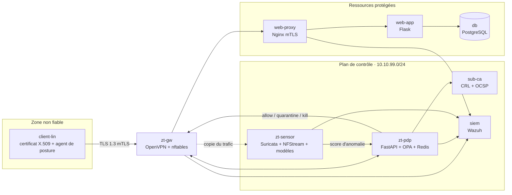

# ZT-PKI-AI

**Accès distant Zero Trust fondé sur la PKI, avec vérification continue du trafic par apprentissage automatique, sans déchiffrement.**

ZT-PKI-AI remplace le modèle « VPN périmétrique », où un utilisateur authentifié joint tout le réseau interne, par un accès accordé ressource par ressource, pour une durée limitée et réévalué en continu. L'ensemble tourne dans un laboratoire de dix machines virtuelles entièrement décrit en code (Vagrant + Ansible), reproductible à partir de ce dépôt.

| | VPN périmétrique | ZT-PKI-AI |
|---|---|---|
| Services joignables par un employé authentifié | 7 / 7 | **2 / 7** |
| Durée d'un droit d'accès | permanente | **10 min, renouvelée si la confiance tient** |
| Certificat volé utilisé sur un poste non conforme | accès conservé | **quarantaine** |
| Panne du moteur de décision | sans effet | **accès fermé (fail-closed)** |
| Surveillance du trafic | déchiffrement, ou rien | **métadonnées de flux uniquement** |
| Surcoût sur le débit | — | **aucun mesurable** |

## Fonctionnalités

- **Identité X.509 de bout en bout** : PKI à deux niveaux (racine ECDSA P-384 hors ligne, autorité émettrice `pathlen:0`), certificats utilisateurs courts (7 jours), profils EKU séparés, CRL et OCSP.
- **Une seule porte d'entrée** : OpenVPN 2.6 en TLS 1.3 avec authentification mutuelle, `tls-crypt` (le port reste muet sans la clé), ECDHE et AES-256-GCM.
- **Décision par session** : un PDP (FastAPI, Open Policy Agent, Redis) calcule un score de confiance à partir de l'identité, de la posture du poste et du comportement réseau, en 20,8 ms (médiane).
- **Droits à durée de vie** : la passerelle nftables refuse tout par défaut ; chaque autorisation est une entrée d'ensemble avec TTL qui disparaît si elle n'est pas renouvelée.
- **Vérification continue sans lecture du contenu** : la sonde extrait 47 statistiques par flux (NFStream) ; trois modèles fusionnés (Isolation Forest, autoencodeur, Random Forest) notent chaque flux. Une alerte critique retire l'accès en moins de 0,5 s.
- **Supervision centralisée** : Suricata et Wazuh 4.14, règles de corrélation dédiées (100100–100161) associées à MITRE ATT&CK, surveillance d'intégrité des fichiers critiques.

## Architecture



La passerelle `zt-gw` est le seul point de passage entre les zones. Le PDP y pose des droits via un compte SSH sans privilège limité à une commande forcée (`allow`, `quarantine`, `clear`, `kill`). L'autorité racine `root-ca` reste éteinte et n'a aucune interface réseau interne.

Score de confiance : `S = 100 × (0,30·I + 0,25·D + 0,15·C + 0,30·(1 − A))`

| Score | Palier | Durée de vie | Effet |
|---|---|---|---|
| ≥ 80 | complet | 10 min | droits du rôle |
| 50 – 79 | restreint | 2 min | web uniquement |
| 20 – 49 | quarantaine | 30 min | canal de posture uniquement |
| < 20 | révoqué | — | règles retirées, tunnel coupé |

## Démarrage rapide

**Prérequis** : hôte Linux avec environ 18 Go de RAM disponibles, VirtualBox 7.1 (la 7.0 duplique des trames sur les réseaux internes), Vagrant, Ansible. Les modules KVM doivent être déchargés pendant l'utilisation de VirtualBox.

```bash
git clone https://github.com/Ahmed1-Rebai/ZT-PKI-AI.git && cd ZT-PKI-AI
sudo modprobe -r kvm_amd kvm           # kvm_intel sur processeur Intel

cd infra
make tools                             # Vagrant + Ansible (Debian/Ubuntu)
make core detection workloads client   # 9 VM ; root-ca reste éteinte
make mgmt-host                         # accès au tableau de bord Wazuh : https://10.10.99.20
make vpn && make vpn-check             # PKI synchronisée, passerelle et poste client déployés
```

Se connecter avec l'identité de test :

```bash
vagrant ssh client-lin
sudo systemctl start openvpn-client@alice
M="--cert /etc/zt-client/client.crt --key /etc/zt-client/client.key --cacert /etc/zt-client/ca-chain.crt"
sudo curl -s $M https://10.10.10.10/api/whoami
```

La construction complète depuis zéro (cérémonie PKI, entraînement des modèles) est décrite dans [`pki/README.md`](pki/README.md), [`ai/README.md`](ai/README.md) et [`infra/README.md`](infra/README.md).

## Validation

```bash
make -C infra isolate          # coupe l'accès Internet des VM pendant les tests
make -C infra scenarios        # 12 scénarios d'attaque, joués depuis client-lin
make -C infra abcd             # benchmark A/B/C/D
make -C infra perf             # latences et débits
make -C infra reconnect
```

Chaque scénario affiche `PASS` ou `FAIL` après un contrôle réel et dépose ses journaux dans [`tests/evidence/`](tests/evidence/).

| Scénario | Attaque | Résultat |
|---|---|---|
| S1 – S4 | sans certificat, autorité inconnue, certificat révoqué, expiré | refusé à la poignée de main |
| S5 – S6 | scan, inondation UDP du port VPN | aucune réponse, service maintenu |
| S7 | SSH hors rôle depuis un tunnel valide | rejeté et journalisé (`ZT-DROP`) |
| S8 | certificat valide sur un poste non conforme | quarantaine |
| S9 | fausse passerelle | refusée par le client |
| S10 | moteur de décision arrêté | aucun tunnel (fail-closed) |
| S11 | modification des règles du pare-feu | alerte Wazuh 100160 |
| S12 | modèle d'IA altéré | refusé par le manifeste SHA-256 |

**Benchmark** : le même laboratoire est reconfiguré en VPN classique (A), Zero Trust statique (B), PDP dynamique (C) et PDP + IA (D). A expose 7 services dont 5 violations ; B, C et D n'en exposent que 2. Seuls C et D mettent en quarantaine un certificat volé utilisé sur un poste non conforme. Débits de 27 à 35 Mb/s dans les quatre configurations : pas de surcoût mesurable. Détails : [`tests/reports/results.md`](tests/reports/results.md), [`tests/reports/perf.md`](tests/reports/perf.md).

**Détection** : F1 0,9943, 0,16 % de faux positifs, 11,6 ms par flux sur CPU, mesurés sur la partie test de CIC-IDS2017 dédupliqué ([`ai/reports/metrics.md`](ai/reports/metrics.md)). Dans le laboratoire, la boucle de réaction a été validée avec une alerte critique simulée.

## Structure du dépôt

```text
├── pki/        PKI OpenSSL : racine hors ligne, autorité émettrice, CRL, OCSP
├── vpn/        OpenVPN 2.6, hooks Python fail-closed, profils clients
├── firewall/   nftables (refus par défaut, ensembles à TTL), commande forcée ztpdp-nft
├── pdp/        moteur de décision : API FastAPI, score de confiance, politiques Rego
├── ai/         caractéristiques, entraînement, registre signé SHA-256, inférence
├── sensor/     copie du trafic (tc mirred), règles Suricata locales
├── siem/       règles de corrélation et tableaux de bord Wazuh
├── apps/       proxy Nginx mTLS, application Flask, PostgreSQL, agent de posture
├── tests/      scénarios, benchmark A/B/C/D, performances, preuves d'exécution
├── infra/      Vagrantfile (10 VM), Ansible (13 rôles), docker-compose, Makefile
└── docs/       documentation de conception
```

## Documentation

| Sujet | Document |
|---|---|
| Modèle de menaces | [docs/01-cadrage-et-modele-de-menaces.md](docs/01-cadrage-et-modele-de-menaces.md) |
| Architecture (NIST SP 800-207) | [docs/02-architecture.md](docs/02-architecture.md) |
| Laboratoire et réseaux | [docs/03-environnement-lab.md](docs/03-environnement-lab.md) · [docs/12-machines.md](docs/12-machines.md) |
| PKI | [docs/04-pki.md](docs/04-pki.md) |
| VPN | [docs/05-vpn.md](docs/05-vpn.md) |
| PDP / PEP | [docs/06-zero-trust-pdp-pep.md](docs/06-zero-trust-pdp-pep.md) |
| Détection | [docs/07-detection-ia.md](docs/07-detection-ia.md) |
| Supervision | [docs/08-supervision-siem.md](docs/08-supervision-siem.md) |
| Tests | [docs/09-tests-et-scenarios.md](docs/09-tests-et-scenarios.md) |

## Sécurité et périmètre

Ce dépôt est un environnement de laboratoire. Les identités, certificats et données qu'il crée sont fictifs ; aucune clé privée n'est versionnée. Les scénarios d'attaque ne doivent être joués que dans le laboratoire isolé, selon [RULES-OF-ENGAGEMENT.md](RULES-OF-ENGAGEMENT.md).

Limites connues : la détection est validée sur un jeu de données public et non sur du trafic de production ; la posture du poste se limite à deux contrôles ; la redistribution de la CRL est manuelle.

