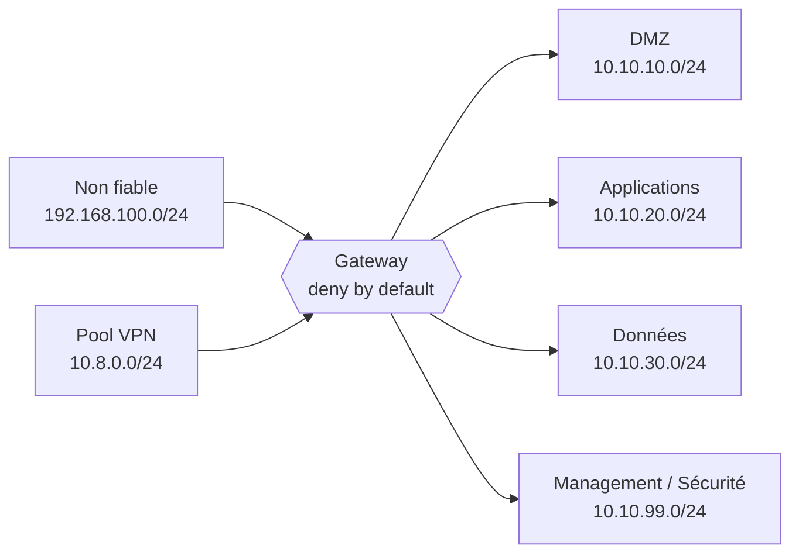
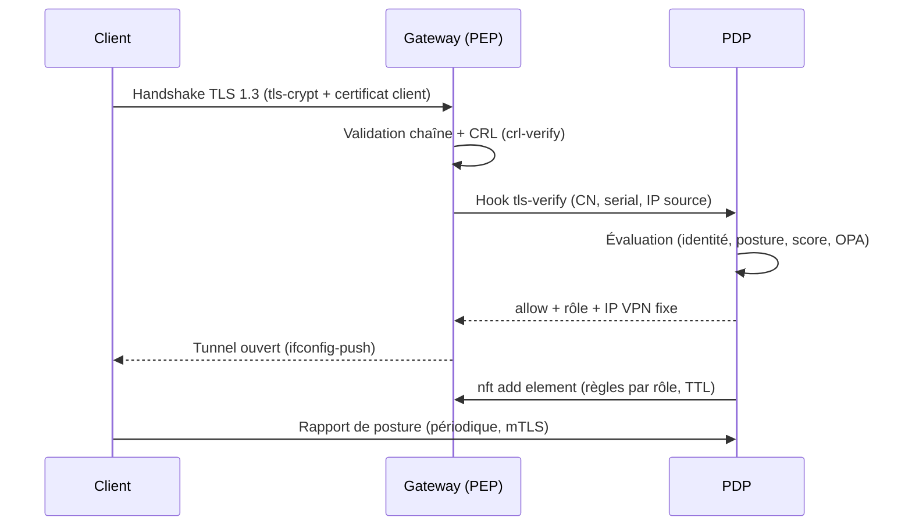
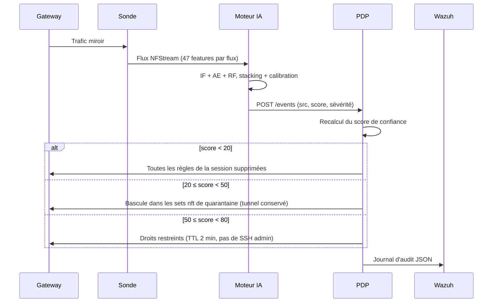

# 02 — Architecture

## 1. Correspondance avec NIST SP 800-207

| Composant NIST | Implémentation dans le projet |
|---|---|
| **Policy Engine (PE)** | Moteur de score de confiance (Python) + OPA (Rego) |
| **Policy Administrator (PA)** | API FastAPI du PDP : crée/supprime sessions et règles |
| **Policy Enforcement Point (PEP)** | Gateway OpenVPN + nftables + reverse proxy mTLS |
| **CDM / Posture** | Agent de posture client (pare-feu actif, marqueur de poste géré), rapport envoyé en mTLS |
| **PKI** | Root CA offline + Issuing CA + CRL/OCSP |
| **Threat intelligence / SIEM** | Suricata + Wazuh |
| **Moteur d'analyse comportementale** | Moteur IA par flux (IF + AE + RF, fusion par stacking) sur la sonde |

## 2. Principes appliqués

1. **Toutes les ressources sont protégées**, quel que soit l'emplacement.
2. **Communications sécurisées**, même en interne (mTLS vers le proxy).
3. **Accès par session**, évalué à chaque demande, avec **TTL court**.
4. **Politique dynamique** : identité + appareil + comportement + contexte.
5. **Surveillance continue** de l'état de tous les actifs.
6. **Authentification et autorisation strictes** avant tout accès.
7. **Collecte maximale d'informations** pour améliorer la posture.

## 3. Vue logique

```mermaid
flowchart TB
  subgraph DP[Plan de données]
    C[Client] -->|OpenVPN mTLS| GW[Gateway / PEP]
    GW -->|HTTPS mTLS| PX[Reverse proxy]
    PX --> APP[Web app]
    APP --> DB[(DB)]
    GW -->|SSH restreint| ADM[Hôtes admin]
  end
  subgraph CP[Plan de contrôle]
    PDP[PDP API + Trust Engine]
    OPA[OPA / Rego]
    REDIS[(Redis : sessions, scores)]
    CA[Issuing CA / OCSP / CRL]
    PDP --- OPA
    PDP --- REDIS
  end
  subgraph SEC[Plan de sécurité / observabilité]
    SENS[Sonde Suricata + NFStream]
    AI[Moteur IA zt-ai]
    SIEM[Wazuh]
  end
  GW <-->|hooks + API| PDP
  C -->|rapport de posture mTLS| PDP
  CA -. CRL copiée (refresh-crl.sh) .-> GW
  GW -. miroir trafic .-> SENS
  SENS --> AI -->|score d'anomalie| PDP
  GW & PDP & AI & SENS --> SIEM
```

## 4. Composants

| Composant | Rôle | Technologie | Zone |
|---|---|---|---|
| Root CA | Ancre de confiance, signe uniquement l'Issuing CA | OpenSSL, VM éteinte | Hors réseau |
| Issuing CA | Émet certificats clients/serveurs, publie CRL/OCSP | OpenSSL, CRL HTTP + répondeur OCSP | Management |
| Gateway | Concentrateur VPN, routeur, pare-feu, PEP | OpenVPN, nftables | Frontière |
| PDP | Décision d'accès, score de confiance, orchestration | FastAPI, OPA, Redis | Management |
| Reverse proxy | Contrôle d'accès applicatif (mTLS) | Nginx | DMZ |
| Sonde | Capture et analyse de trafic | Suricata, NFStream | Management (miroir) |
| Moteur IA | Détection d'anomalies par flux, envoi des événements au PDP | scikit-learn, PyTorch (inférence sur zt-sensor, entraînement sur l'hôte) | Management |
| SIEM | Collecte, corrélation, alertes | Wazuh | Management |
| App / DB | Charge de travail à protéger | Flask/Nginx, PostgreSQL | App / Data |
| Client | Poste Linux de l'utilisateur + agent posture ; sert aussi de machine de test pour les scénarios d'attaque | OpenVPN, Python | Non fiable |

## 5. Zones de sécurité



Règle générale : **tout flux inter-zones transite par la gateway** ; aucune zone n'a de route directe vers une autre.

## 6. Flux principaux

### 6.1 Établissement de session



### 6.2 Boucle de vérification continue



## 7. Score de confiance (aperçu)

```
TrustScore = 100 × ( 0.30·Identité + 0.25·Appareil + 0.15·Contexte + 0.30·(1 − Anomalie) )
```

| Score | Niveau | Action |
|---|---|---|
| ≥ 80 | Confiance élevée | Droits complets du rôle, TTL 10 min |
| 50–79 | Confiance moyenne | Droits restreints (pas de SSH admin), TTL 2 min |
| 20–49 | Faible | Quarantaine 30 min (seul le canal de posture reste joignable) |
| < 20 | Compromis | Toutes les règles de la session supprimées |

Les endpoints `/v1/session/{cn}/kill` et `/v1/cert/{serial}/revoke` coupent en plus le tunnel (`ztpdp-nft kill` via SSH sur la gateway) ; la régénération de la CRL reste une opération manuelle.

Détails : voir [06](06-zero-trust-pdp-pep.md).

## 8. Décisions d'architecture (ADR)

| ID | Décision | Alternatives | Justification |
|---|---|---|---|
| ADR-1 | **OpenVPN** (mTLS) | WireGuard, strongSwan IKEv2 | Authentification X.509 native, hooks de scripts, interface de management ; WireGuard utilise des clés brutes, sans PKI |
| ADR-2 | **nftables sets avec timeout** | iptables, eBPF/XDP | Mises à jour atomiques, TTL natif, simple à piloter |
| ADR-3 | **FastAPI + OPA** | Tout en Python / Keycloak | Politique déclarative et testable (Rego), séparation décision/logique |
| ADR-4 | **Wazuh** | ELK, Splunk | Open source, agents, règles prêtes, FIM |
| ADR-5 | **Suricata + NFStream** | Zeek, CICFlowMeter | Suricata pour signatures, NFStream pour features statistiques en Python |
| ADR-6 | **Multi-modèles IA** (IF + AE + RF, stacking) | Un seul modèle | Complémentarité : anomalies inconnues (IF, AE) vs attaques connues (RF) |
| ADR-7 | **Fail-closed** | Fail-open | Cohérent avec Zero Trust |
| ADR-8 | **Certificats courts** (7 j) | 1 an | Réduit la fenêtre d'exploitation d'un cert volé |

## 9. Sécurité de l'architecture elle-même

- **mTLS** vers l'API du PDP (hooks de la gateway, moteur IA, agent de posture), avec des certificats de service émis par la PKI. La CRL et l'OCSP de l'Issuing CA sont servis en HTTP simple ; le PDP n'interroge pas la CA.
- Secrets montés dans le conteneur du PDP depuis `/etc/zt-pdp/certs` et `/etc/zt-pdp/ssh` (lecture seule), jamais dans Git.
- Journal d'audit du PDP envoyé en temps réel au SIEM.
- Modèles IA vérifiés au chargement contre un manifeste SHA-256 (`ai/registry.py`).
- Pare-feu de la gateway protégé : SSH uniquement depuis la zone Management.
