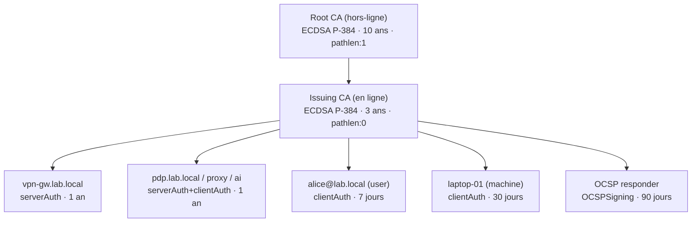

# 04 — Infrastructure à clés publiques (PKI)

## 1. Hiérarchie



### Choix cryptographiques
| Élément | Choix | Justification |
|---|---|---|
| Algorithme | ECDSA P-384 (CA), P-256 (feuilles) | Clés courtes, TLS 1.3 compatible |
| Hash | SHA-384 (CA) / SHA-256 (feuilles) | Robuste |
| Durée feuilles | 7 à 30 jours | Limite l'impact d'un vol de cert |
| Révocation | CRL (24 h) + OCSP | Redondance, PDP interroge OCSP |
| Protection clé racine | Chiffrée AES-256, VM éteinte, copie sur support chiffré | Root offline |

## 2. Arborescence

```
pki/
├── root/
│   ├── root.cnf
│   ├── private/root.key
│   ├── certs/root.crt
│   ├── newcerts/  index.txt  serial  crlnumber
├── sub/
│   ├── sub.cnf
│   ├── private/{sub.key, vpn-gw.key, ...}
│   ├── certs/{sub.crt, ca-chain.crt, ...}
│   ├── csr/  newcerts/  crl/  index.txt  serial  crlnumber
└── scripts/{issue-client.sh, revoke.sh, gencrl.sh, renew.sh}
```

## 3. Configuration OpenSSL (extraits)

### `root/root.cnf`
```ini
[ ca ]
default_ca = CA_default

[ CA_default ]
dir               = /pki/root
certs             = $dir/certs
new_certs_dir     = $dir/newcerts
database          = $dir/index.txt
serial            = $dir/serial
crlnumber         = $dir/crlnumber
private_key       = $dir/private/root.key
certificate       = $dir/certs/root.crt
default_md        = sha384
policy            = policy_strict
default_days      = 1095
unique_subject    = no
copy_extensions   = none

[ policy_strict ]
countryName         = match
organizationName    = match
commonName          = supplied

[ req ]
default_bits        = 384
distinguished_name  = dn
string_mask         = utf8only
default_md          = sha384

[ dn ]
countryName         = Pays
organizationName    = Organisation
commonName          = Nom commun

[ v3_root_ca ]
subjectKeyIdentifier   = hash
authorityKeyIdentifier = keyid:always,issuer
basicConstraints       = critical, CA:true, pathlen:1
keyUsage               = critical, keyCertSign, cRLSign

[ v3_intermediate_ca ]
subjectKeyIdentifier   = hash
authorityKeyIdentifier = keyid:always,issuer
basicConstraints       = critical, CA:true, pathlen:0
keyUsage               = critical, keyCertSign, cRLSign
```

### `sub/sub.cnf` (extensions des certificats feuilles)
```ini
[ client_cert ]
basicConstraints       = CA:false
subjectKeyIdentifier   = hash
authorityKeyIdentifier = keyid,issuer
keyUsage               = critical, digitalSignature
extendedKeyUsage       = clientAuth
crlDistributionPoints  = URI:http://10.10.99.5/crl/sub.crl
authorityInfoAccess    = OCSP;URI:http://10.10.99.5:2560

[ server_cert ]
basicConstraints       = CA:false
subjectKeyIdentifier   = hash
authorityKeyIdentifier = keyid,issuer
keyUsage               = critical, digitalSignature
extendedKeyUsage       = serverAuth
subjectAltName         = @alt_names
crlDistributionPoints  = URI:http://10.10.99.5/crl/sub.crl
authorityInfoAccess    = OCSP;URI:http://10.10.99.5:2560

[ ocsp_cert ]
basicConstraints       = CA:false
keyUsage               = critical, digitalSignature
extendedKeyUsage       = critical, OCSPSigning

[ alt_names ]
DNS.1 = vpn-gw.lab.local
IP.1  = 192.168.100.1
```

> Les **rôles** (employé, admin, prestataire) ne sont **pas** codés dans le certificat : le certificat prouve l'identité, le PDP (source de vérité) attribue les droits. Cela permet de changer un rôle sans réémettre de certificat.

## 4. Mise en place pas à pas

### 4.1 Root CA (machine hors-ligne)
```bash
cd /pki/root && mkdir -p certs newcerts private && touch index.txt
echo 1000 > serial && echo 1000 > crlnumber && chmod 700 private

openssl genpkey -algorithm EC -pkeyopt ec_paramgen_curve:P-384 \
  -aes-256-cbc -out private/root.key

openssl req -config root.cnf -new -x509 -days 3650 -sha384 \
  -extensions v3_root_ca -key private/root.key \
  -subj "/C=TN/O=ZT-Lab/CN=ZT-Lab Root CA" -out certs/root.crt
```

### 4.2 Issuing CA
```bash
# Sur sub-ca
openssl genpkey -algorithm EC -pkeyopt ec_paramgen_curve:P-384 \
  -aes-256-cbc -out private/sub.key
openssl req -config sub.cnf -new -sha384 -key private/sub.key \
  -subj "/C=TN/O=ZT-Lab/CN=ZT-Lab Issuing CA" -out csr/sub.csr

# Transfert du CSR (USB) vers root-ca, puis signature :
openssl ca -config root.cnf -extensions v3_intermediate_ca \
  -days 1095 -notext -md sha384 -in sub.csr -out sub.crt

# Chaîne
cat sub.crt root.crt > ca-chain.crt
openssl verify -CAfile root.crt sub.crt
```

### 4.3 Certificat serveur (gateway)
```bash
openssl genpkey -algorithm EC -pkeyopt ec_paramgen_curve:prime256v1 -out private/vpn-gw.key
openssl req -new -key private/vpn-gw.key -subj "/C=TN/O=ZT-Lab/CN=vpn-gw.lab.local" -out csr/vpn-gw.csr
openssl ca -config sub.cnf -extensions server_cert -days 365 -notext -md sha256 \
  -in csr/vpn-gw.csr -out certs/vpn-gw.crt
```

### 4.4 Certificat client (script `issue-client.sh`)
```bash
#!/usr/bin/env bash
set -euo pipefail
USER="$1"                 # ex: alice
DAYS="${2:-7}"
DEV="${3:-$(uuidgen)}"    # identifiant d'appareil
cd /pki/sub

openssl genpkey -algorithm EC -pkeyopt ec_paramgen_curve:prime256v1 -out private/$USER.key
openssl req -new -key private/$USER.key \
  -subj "/C=TN/O=ZT-Lab/CN=$USER@lab.local" -out csr/$USER.csr
openssl ca -batch -config sub.cnf -extensions client_cert -days "$DAYS" \
  -notext -md sha256 -in csr/$USER.csr -out certs/$USER.crt

echo "$USER,$DEV,$(openssl x509 -in certs/$USER.crt -noout -serial | cut -d= -f2)" \
  >> /pki/inventory.csv
```

> Pour lier le cert à un appareil, étendre avec `subjectAltName = URI:urn:device:<uuid>` et enregistrer l'empreinte dans l'inventaire du PDP.

## 5. Révocation

```bash
# Révoquer
openssl ca -config sub.cnf -revoke certs/alice.crt -crl_reason keyCompromise
# Générer la CRL (cron toutes les heures + à chaque révocation)
openssl ca -config sub.cnf -gencrl -out crl/sub.crl
openssl crl -in crl/sub.crl -out crl/sub.pem
# Copier vers la gateway
scp crl/sub.pem zt-gw:/etc/openvpn/server/crl.pem

# Vérifier
openssl verify -crl_check -CAfile <(cat ca-chain.crt crl/sub.pem) certs/alice.crt
```

### OCSP responder
```bash
openssl ocsp -port 2560 -text -sha256 \
  -index index.txt -CA ca-chain.crt \
  -rkey private/ocsp.key -rsigner certs/ocsp.crt
# Test
openssl ocsp -issuer sub.crt -cert certs/alice.crt -url http://10.10.99.5:2560 -CAfile ca-chain.crt
```

> La CRL seule a un délai de propagation : le **PDP vérifie aussi OCSP** et sa propre liste de révocation Redis pour une révocation quasi immédiate.

## 6. Cycle de vie

| Phase | Action | Automatisation |
|---|---|---|
| Enrôlement | Génération clé locale + CSR, validation par admin | `issue-client.sh` |
| Renouvellement | Avant expiration (J−2) | `renew.sh` ou ACME (step-ca) |
| Révocation | Incident ou score < 20 | API PDP → `revoke.sh` |
| Expiration | Cert expiré = refus automatique | natif |
| Audit | `index.txt` + journaux d'émission vers SIEM | rsyslog/Wazuh |

## 7. Extensions (bonus)

- **step-ca** (smallstep) avec ACME / provisioner OIDC pour renouvellement automatique de certificats de 24 h.
- Clé de l'Issuing CA dans **SoftHSM / YubiHSM / YubiKey (PKCS#11)**.
- Clé client liée au **TPM** (certificat non exportable).
- **Name constraints** sur l'Issuing CA (`.lab.local`).

## 8. Menaces PKI et contre-mesures

| Menace | Contre-mesure |
|---|---|
| Vol clé racine | Root hors-ligne, clé chiffrée, coffre physique |
| Émission frauduleuse | `pathlen:0`, journal d'émission, double validation |
| Cert client volé | Durée courte, révocation, posture, UEBA |
| Retard de CRL | OCSP + liste de révocation PDP |
| Algorithme faible | ECDSA P-256/P-384, SHA-2 |

## 9. Tests PKI

| Test | Commande | Attendu |
|---|---|---|
| Chaîne valide | `openssl verify -CAfile root.crt sub.crt` | OK |
| Cert expiré | Émettre avec `-days 0` / avancer l'horloge | Refus |
| Cert révoqué | `openssl verify -crl_check ...` | `certificate revoked` |
| EKU incorrect | Utiliser un cert serveur comme client | Refus VPN |
