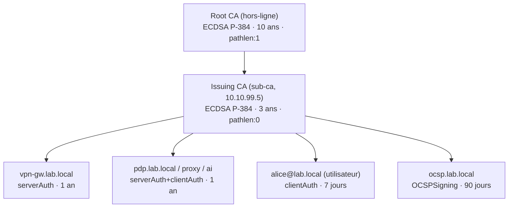

# 04 — Infrastructure à clés publiques (PKI)

## 1. Hiérarchie



Il n'y a pas de profil de certificat machine : `issue-client.sh` émet un certificat utilisateur et enregistre l'identifiant d'appareil fourni dans `pki/sub/inventory.csv`.

### Choix cryptographiques
| Élément | Choix | Justification |
|---|---|---|
| Algorithme | ECDSA P-384 (CA), P-256 (feuilles) | Clés courtes, compatible TLS 1.3 |
| Hash | SHA-384 (Root) / SHA-256 (Issuing CA et feuilles) | Robuste |
| Durée feuilles | 7 jours pour les utilisateurs (alice dans la démo), 1 an pour les serveurs | Limite l'impact d'un vol de certificat client |
| Révocation | CRL (validité 24 h, `default_crl_days = 1`) + répondeur OCSP sur :2560 | Vérification CRL par OpenVPN et nginx, OCSP disponible pour tout client |
| Protection clé racine | Clé chiffrée AES-256, VM `root-ca` éteinte et sans carte réseau | Root hors-ligne |

## 2. Arborescence

```
pki/
├── root/
│   ├── root.cnf
│   ├── private/root.key          (générés sur root-ca, jamais commités)
│   ├── certs/{root.crt, sub.crt, ca-chain.crt}
│   └── newcerts/  crl/  index.txt  serial  crlnumber
├── sub/
│   ├── sub.cnf
│   ├── private/{sub.key, ocsp.key, <cn>.key, ...}
│   ├── certs/{sub.crt, ca-chain.crt, ocsp.crt, <cn>.crt, ...}
│   ├── csr/  newcerts/  crl/  index.txt  serial  crlnumber  inventory.csv
├── scripts/   init-root.sh init-sub.sh sign-sub.sh issue-server.sh issue-client.sh
│              revoke.sh gencrl.sh renew.sh ocsp.sh refresh-crl.sh
└── systemd/   zt-crl.service zt-ocsp.service
```

Seuls `root.cnf`, `sub.cnf`, les scripts et les unités systemd sont versionnés ; clés, certificats et `inventory.csv` restent sur les VM.

## 3. Configuration OpenSSL (extraits)

Fichiers complets : `pki/root/root.cnf` et `pki/sub/sub.cnf`. Les chemins sont relatifs à la racine du dépôt (`dir = ./pki/root`, `dir = ./pki/sub`) ; les scripts font `cd` vers `PKI_BASE` (par défaut la racine du dépôt).

### `pki/root/root.cnf`
```ini
[ CA_default ]
dir               = ./pki/root
...
default_md        = sha384
default_days      = 1095
policy            = policy_strict
copy_extensions   = none

[ v3_root_ca ]
basicConstraints       = critical, CA:true, pathlen:1
keyUsage               = critical, keyCertSign, cRLSign

[ v3_intermediate_ca ]
basicConstraints       = critical, CA:true, pathlen:0
keyUsage               = critical, keyCertSign, cRLSign
```

### `pki/sub/sub.cnf` (profils des certificats feuilles)
```ini
[ CA_default ]
dir               = ./pki/sub
default_md        = sha256
default_days      = 365
default_crl_days  = 1
copy_extensions   = copy

[ client_cert ]
keyUsage               = critical, digitalSignature
extendedKeyUsage       = clientAuth
crlDistributionPoints  = URI:http://10.10.99.5/crl/sub.crl
authorityInfoAccess    = OCSP;URI:http://10.10.99.5:2560

[ server_cert ]
keyUsage               = critical, digitalSignature, keyEncipherment
extendedKeyUsage       = serverAuth

[ server_client_cert ]          # PDP, proxy, services IA (mTLS)
keyUsage               = critical, digitalSignature, keyEncipherment
extendedKeyUsage       = serverAuth, clientAuth

[ ocsp_cert ]
keyUsage               = critical, digitalSignature
extendedKeyUsage       = critical, OCSPSigning
```

Les SAN des certificats serveur ne sont pas dans `sub.cnf` : `issue-server.sh` les passe à la CSR (`-addext subjectAltName=...`) et `copy_extensions = copy` les reporte dans le certificat.

> Les **rôles** (employé, admin, prestataire) ne sont **pas** codés dans le certificat : le certificat prouve l'identité, le PDP (`pdp/policies/data.json`) attribue les droits. Un rôle peut donc changer sans réémettre de certificat.

## 4. Mise en place pas à pas

Toutes les étapes passent par les scripts de `pki/scripts/`. Les clés des deux CA sont chiffrées ; chaque script demande la phrase de passe, sauf si `PKI_PASS` est défini (usage labo).

| Script | Machine | Rôle |
|---|---|---|
| `init-root.sh` | root-ca | Arborescence, clé P-384 chiffrée, certificat racine auto-signé 10 ans (`v3_root_ca`) |
| `init-sub.sh` | sub-ca | Arborescence, clé P-384 chiffrée, CSR `pki/sub/csr/sub.csr` |
| `sign-sub.sh <csr>` | root-ca | Signature de l'Issuing CA (`v3_intermediate_ca`, 1095 jours, SHA-384) et construction de `ca-chain.crt` |
| `issue-server.sh <CN> <SANs> [ext] [jours]` | sub-ca | Certificat serveur (`server_cert`) ou serveur+client (`server_client_cert`) |
| `issue-client.sh <user> [jours] [appareil]` | sub-ca | Certificat utilisateur `clientAuth` + ligne d'inventaire |
| `ocsp.sh` | sub-ca | Crée le signataire OCSP s'il manque, puis lance le répondeur au premier plan |
| `revoke.sh <cert> [raison]` | sub-ca | Révocation + régénération de la CRL |
| `gencrl.sh` | sub-ca | Génère la CRL et la publie dans le répertoire servi en HTTP |
| `renew.sh <cert> [jours]` | sub-ca | Réémission avec la même clé et le même CN, profil déduit de l'EKU |
| `refresh-crl.sh` | hôte | Régénère la CRL sur sub-ca et la déploie sur zt-gw et web-proxy |

### 4.1 Root CA et Issuing CA (cérémonie)
```bash
# sur root-ca
pki/scripts/init-root.sh
# sur sub-ca
pki/scripts/init-sub.sh                       # -> pki/sub/csr/sub.csr
# CSR transféré sur root-ca, puis :
pki/scripts/sign-sub.sh pki/sub/csr/sub.csr   # -> pki/root/certs/{sub.crt,ca-chain.crt}
# sub.crt et ca-chain.crt recopiés dans pki/sub/certs/ ; root-ca est ensuite éteinte
```

Extrait de `sign-sub.sh` :
```bash
openssl ca -config "$R/root.cnf" -batch $PASS_IN -extensions v3_intermediate_ca \
  -days 1095 -notext -md sha384 -in "$CSR" -out "$R/certs/sub.crt"
cat "$R/certs/sub.crt" "$R/certs/root.crt" > "$R/certs/ca-chain.crt"
openssl verify -CAfile "$R/certs/root.crt" "$R/certs/sub.crt"
```

### 4.2 Certificats serveur
```bash
pki/scripts/issue-server.sh vpn-gw.lab.local vpn-gw.lab.local,IP:192.168.100.1 server_cert 365
pki/scripts/issue-server.sh pdp.lab.local    pdp.lab.local,IP:10.10.99.10 server_client_cert 365
```

### 4.3 Certificat client (`issue-client.sh`)
Extrait :
```bash
openssl genpkey -algorithm EC -pkeyopt ec_paramgen_curve:prime256v1 -out "$key"
openssl req -config "$S/sub.cnf" -new -key "$key" -subj "/C=TN/O=ZT-Lab/CN=${CN}" -out "$csr"
openssl ca -config "$S/sub.cnf" -batch $PASS_IN -extensions client_cert -days "$DAYS" \
  -notext -md sha256 -in "$csr" -out "$crt"

serial=$(openssl x509 -in "$crt" -noout -serial | cut -d= -f2)
echo "${USER},${DEV},${serial},$(date -u +%FT%TZ)" >> "$S/inventory.csv"
```

Avec `jours = 0`, le script émet un certificat déjà expiré (fenêtre de deux jours terminée une heure plus tôt) pour le scénario S4, car `openssl ca -days 0` est refusé.

## 5. Révocation et publication

```bash
pki/scripts/revoke.sh pki/sub/certs/bob.crt keyCompromise   # révoque puis appelle gencrl.sh
```

`gencrl.sh` écrit `pki/sub/crl/sub.crl` (DER) et `sub.pem`, puis copie la version DER dans `/home/vagrant/crlpub/crl/`, servi par `zt-crl.service` (`python3 -m http.server 80`) à l'adresse du point de distribution `http://10.10.99.5/crl/sub.crl`.

La CRL n'est valable que 24 h ; une CRL expirée fait refuser tous les certificats par OpenVPN et nginx. Il n'y a pas de tâche planifiée : avant une session de démo ou de test, on lance depuis l'hôte

```bash
bash pki/scripts/refresh-crl.sh
```

qui exécute `gencrl.sh` sur sub-ca, rapatrie le matériel avec `vpn/scripts/sync-pki.sh` et `apps/proxy/sync-pki.sh`, l'installe dans `/etc/openvpn/server/crl.pem` sur zt-gw et dans le fichier `ssl_crl` de nginx sur web-proxy (avec `systemctl reload nginx`), puis affiche les dates `nextUpdate` déployées.

### Répondeur OCSP
`zt-ocsp.service` lance le répondeur de l'Issuing CA sur le port 2560 (le signataire est créé une fois par `ocsp.sh`) :
```ini
ExecStart=/usr/bin/openssl ocsp -port 2560 -index /home/vagrant/pki/sub/index.txt -CA /home/vagrant/pki/sub/certs/ca-chain.crt -rkey /home/vagrant/pki/sub/private/ocsp.key -rsigner /home/vagrant/pki/sub/certs/ocsp.crt -ignore_err
```
Le répondeur d'OpenSSL ne lit `index.txt` qu'au démarrage : il faut le redémarrer après chaque révocation. Les deux unités de `pki/systemd/` sont installées à la main sur sub-ca.

```bash
# test
openssl ocsp -issuer pki/sub/certs/sub.crt -cert pki/sub/certs/alice.crt \
  -url http://10.10.99.5:2560 -CAfile pki/sub/certs/ca-chain.crt
```

> Le PDP n'interroge ni la CRL ni l'OCSP. Il tient sa propre liste de numéros de série révoqués (ensemble Redis `zt:revoked`) : un certificat présent dans cette liste donne un facteur d'identité nul et la session est refusée. `POST /v1/cert/{serial}/revoke` ajoute le numéro de série à cette liste et coupe les sessions ouvertes, mais ne touche pas à la CRL : la réponse contient `"crl_update": "operator-required"` et la révocation PKI reste une action manuelle avec `revoke.sh`.

## 6. Cycle de vie

| Phase | Action | Outil |
|---|---|---|
| Enrôlement | Clé et CSR générées sur sub-ca, signature par l'Issuing CA | `issue-client.sh`, `issue-server.sh` |
| Renouvellement | Réémission avec la même clé avant expiration | `renew.sh` (manuel) |
| Révocation | Incident constaté par l'opérateur | `revoke.sh`, puis `refresh-crl.sh` ; côté PDP, liste Redis via l'API |
| Expiration | Certificat expiré refusé par OpenVPN et nginx | natif |
| Audit | `index.txt` de la CA | Surveillance d'intégrité (FIM) Wazuh sur `/home/vagrant/pki` de sub-ca |

## 7. Menaces PKI et contre-mesures

| Menace | Contre-mesure |
|---|---|
| Vol clé racine | Root hors-ligne (VM éteinte, sans réseau), clé chiffrée |
| Émission frauduleuse par une CA subordonnée | `pathlen:0` sur l'Issuing CA, `index.txt` surveillé par la FIM Wazuh |
| Certificat client volé | Durée courte, révocation, posture de l'appareil et score de confiance au PDP |
| Retard de propagation de la CRL | Liste de révocation Redis du PDP, OCSP disponible |
| Algorithme faible | ECDSA P-256/P-384, SHA-2 |

## 8. Tests PKI

| Test | Commande | Résultat |
|---|---|---|
| Chaîne valide | `openssl verify -CAfile root.crt sub.crt` | OK |
| Certificat expiré (S4) | `issue-client.sh bob 0` puis connexion VPN | Refus |
| Certificat révoqué (S3) | `revoke.sh`, `refresh-crl.sh`, connexion VPN | `certificate revoked`, refus |
| CA non reconnue (S2) | Certificat émis par une CA externe | Refus |

Le contrôle d'EKU (OpenVPN `remote-cert-tls client`, profils `client_cert` / `server_cert`) est configuré mais n'a pas fait l'objet d'un test dédié.
