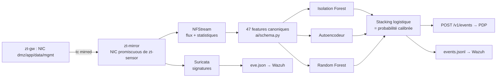

# 07 — Détection intelligente des anomalies réseau par IA

## 1. Objectifs

- Détecter les **attaques connues** (supervisé) et les **flux anormaux inconnus** (non supervisé), flux par flux.
- Produire un **score continu ∈ [0,1]** calibré, consommé par le PDP comme terme d'anomalie du score de confiance.
- Mesurer la qualité des modèles (F1, FPR, ROC-AUC, latence) sur un jeu de test jamais vu.

Les modèles n'utilisent que des **métadonnées de flux** (statistiques de taille, de durée, d'inter-arrivée, drapeaux TCP, port de destination), jamais le contenu des paquets. Ils sont entraînés localement sur le GPU de l'hôte, puis déployés avec leur manifeste SHA-256 sur `zt-sensor`, où l'inférence tourne sur CPU.

## 2. Pipeline



La gateway copie le trafic de ses interfaces de zone (dmz, app, data, mgmt) vers l'interface `zt-mirror` (10.10.98.1) avec `tc mirred` (`sensor/mirror.sh`, unité `zt-mirror`). Côté zones, le trafic des clients est déjà déchiffré et garde son adresse de tunnel (10.8.0.x, pas de NAT), ce qui permet d'attribuer chaque flux à une identité. `zt-sensor` écoute cette copie sur son interface 10.10.98.12 en mode promiscuous.

Suricata tourne sur la même interface mais **ne participe pas au score** : ses alertes partent dans `eve.json` vers Wazuh, où la règle 100150 les corrèle avec les alertes critiques de l'IA (docs/08).

## 3. Données

| Source | Usage |
|---|---|
| **CIC-IDS2017** `MachineLearningCSV` | Entraînement, validation et test |

- 2 830 743 flux (vérifiés contre les totaux publiés), 15 étiquettes.
- 850 380 doublons exacts supprimés → **1 980 363 flux uniques** (336 739 attaques). Sans cette étape, des lignes identiques se retrouvent à la fois en entraînement et en test.
- Découpage **aléatoire stratifié par étiquette** (`ai/data.py`, graine 42) : train 1 188 219 / val 396 072 / test 396 072.

Aucun trafic du lab n'a été capturé ni étiqueté pour l'entraînement.

## 4. Extraction des features

`ai/schema.py` définit 47 features canoniques, alimentées par deux extracteurs :

- **CICFlowMeter** (colonnes des CSV CIC-IDS2017) pour l'entraînement ;
- **NFStream** (`statistical_analysis=True`) sur `zt-sensor` pour l'inférence.

Les deux sont ramenés aux mêmes noms et unités (durées et IAT en ms, tailles en octets) ; les débits et ratios sont recalculés à partir des compteurs de base plutôt que repris de l'extracteur (`Flow Bytes/s` de CICFlowMeter contient des inf/NaN).

| Groupe | Features |
|---|---|
| Volume / durée | `duration_ms`, `fwd_pkts`, `bwd_pkts`, `fwd_bytes`, `bwd_bytes` |
| Taille des paquets | max/min/moyenne/écart-type par sens et bidirectionnel (`fwd_ps_*`, `bwd_ps_*`, `ps_*`) |
| Inter-arrivées | `iat_*`, `fwd_iat_*`, `bwd_iat_*` (moyenne, écart-type, max, min) |
| Drapeaux TCP | `syn`, `fin`, `rst`, `psh`, `ack`, `urg` |
| Port de destination | `port_web`, `port_ssh`, `port_dns`, `port_ftp`, `port_mail`, `port_low`, `port_high` |
| Dérivées | `bytes_per_s`, `pkts_per_s`, `bytes_per_pkt`, `bytes_ratio`, `pkts_ratio` |

Prétraitement (`ai/models.py`, `Preprocessor`) : `log1p` puis standardisation, ajustés sur le trafic bénin d'entraînement.

## 5. Modèles

| Modèle | Type | Entraînement | Rôle |
|---|---|---|---|
| **Isolation Forest** | Non supervisé | Bénin d'entraînement seulement (300 000 flux, 200 arbres) | Flux anormaux inconnus |
| **Autoencodeur** (PyTorch, 47-32-16-8) | Non supervisé | Bénin seulement, GPU, 15 époques, meilleure époque sur la validation | Erreur de reconstruction |
| **Random Forest** | Supervisé | Toutes les attaques + 600 000 flux bénins, `class_weight="balanced_subsample"` | Attaques connues |

Le code est dans `ai/models.py` (prétraitement, autoencodeur, normalisations) et `ai/train.py` (entraînement, évaluation, export). Extrait de `ai/train.py` :

```python
iforest = IsolationForest(n_estimators=200, random_state=0, n_jobs=-1).fit(Z[sub])
ae = train_autoencoder(Z[sub], Z[bva], epochs=5 if args.quick else 15, device=device, log=log)
rf = RandomForestClassifier(n_estimators=200, n_jobs=-1, random_state=0,
                            class_weight="balanced_subsample", min_samples_leaf=2)
```

Lancement sur l'hôte : `./.venv/bin/python ai/train.py` (≈ 6 min ; `--quick` pour un essai rapide).

## 6. Fusion et calibration du score

Chaque modèle est ramené à un score ∈ [0,1], avec des paramètres ajustés sur la validation bénigne :

- Isolation Forest : `clip((raw - lo) / (hi - lo))`, `lo`/`hi` = percentiles 1 et 99,9 ;
- autoencodeur : `clip(err / (2 * thr))`, `thr` = percentile 99,5 de l'erreur ;
- Random Forest : `predict_proba`.

Le modèle servi fusionne ces trois scores par **stacking** : une régression logistique ajustée sur la validation, dont la sortie est directement une probabilité d'attaque calibrée (`ai/scoring.py`) :

```python
fused = self.stacker.predict_proba(np.column_stack([c["iforest"], c["ae"], c["rf"]]))[:, 1]
```

Une fusion à poids fixes suivie d'une calibration isotonique est aussi évaluée pour comparaison, mais n'est pas servie.

## 7. Explicabilité

`ai/train.py` calcule une importance **globale** SHAP (`TreeExplainer` sur le Random Forest, 1 500 attaques du test) et l'écrit dans `ai/reports/metrics.json`. Les statistiques de taille des paquets du sens serveur → client dominent (`bwd_ps_std`, `ps_std`, `bwd_ps_mean`, `bwd_ps_max`, `ps_max`, `bwd_bytes`). Aucune explication n'est calculée en ligne : les événements envoyés au PDP contiennent les scores des trois modèles, pas de features explicatives.

## 8. Service d'inférence — `ai/serve.py`

Le rôle Ansible `sensor` déploie le code, les modèles et l'identité mTLS du moteur dans `/opt/zt-ai` sur `zt-sensor`, et installe le service systemd `zt-ai` (utilisateur `ztai`, capacités `CAP_NET_RAW`/`CAP_NET_ADMIN` seulement). L'interface de capture est résolue à partir de l'adresse 10.10.98.12 et passée par `ZT_CAPTURE_IF`. La sortie JSON va dans `/var/log/zt-ai/events.jsonl`.

Fonctionnement :

1. `Scorer()` charge les modèles via `ai/registry.py`, qui refuse tout artefact dont le SHA-256 ne correspond pas à `models/manifest.json`.
2. NFStream capture en mode promiscuous (`idle_timeout=5`, `active_timeout=15`).
3. Seuls les flux dont la source est dans 10.8.0.0/24 sont traités ; l'adresse de tunnel est traduite en CN grâce à `GET /v1/sessions` du PDP (rafraîchi toutes les 10 s).
4. Chaque flux est converti (`from_nfstream`) puis scoré.
5. Envoi au PDP (`PdpClient`, HTTPS mTLS avec le certificat `ai.crt`) :
   - score ≥ 0,3 → rapport, au plus un par seconde et par utilisateur ;
   - ≥ 5 flux à ≥ 0,95 en 10 s → rapport `critical=true` ;
   - toutes les 30 s, un rapport « heartbeat » avec le score maximal récent de chaque utilisateur actif, pour que la moyenne du PDP redescende quand l'activité cesse.

```python
stream = NFStreamer(source=args.iface, statistical_analysis=True, promiscuous_mode=True,
                    idle_timeout=5, active_timeout=15)
...
critical = len(q) >= args.burst
if (a >= args.report and now - last_report[cn] >= 1.0) or critical:
    r = pdp.report(cn, a, detail, critical)
```

Côté PDP, l'anomalie est lissée par une moyenne mobile exponentielle (α = 0,4) ; un événement critique est appliqué immédiatement et force le score de confiance à 0, donc le palier `revoke` (toutes les règles de la session retirées). La boucle IA → PDP → PEP a été mesurée avec des événements simulés : règle retirée en 0,36 à 0,43 s.

## 9. Évaluation

### Métriques (E1, split de test CIC-IDS2017)

| Modèle | F1 | FPR | ROC-AUC | PR-AUC |
|---|---|---|---|---|
| Isolation Forest | 0,0035 | 0,96 % | 0,868 | 0,404 |
| Autoencodeur | 0,6565 | 1,01 % | 0,964 | 0,856 |
| Random Forest | 0,9942 | 0,19 % | 1,000 | 0,9999 |
| Fusion poids fixes + isotonique | 0,9896 | 0,33 % | 0,9996 | 0,997 |
| **Stacking (servi)** | **0,9943** | **0,16 %** | **0,9999** | **0,9995** |

Latence : **11,6 ms par flux**, un flux à la fois, sur le CPU de l'hôte (mesurée dans `train.py`). Par famille, la détection dépasse 99 % pour DDoS, DoS, brute force et scan de ports, 96,9 % pour les attaques web, mais seulement **≈ 74 %** pour Botnet. Détail : [`ai/reports/metrics.md`](../ai/reports/metrics.md).

Une seule expérience a été menée :

| Exp. | Question | Méthode |
|---|---|---|
| E1 | Quel modèle est le meilleur ? | Comparaison IF / AE / RF / fusion à poids fixes / stacking sur le même split de test |

## 10. Mise à jour et sécurité du ML

- Chaque entraînement écrit `ai/models/manifest.json` avec le SHA-256 de `baseline.joblib` et `ae.pt` ; `ai/registry.py` vérifie ces empreintes avant de désérialiser quoi que ce soit. Le scénario S12 montre qu'un modèle modifié est refusé.
- Sur `zt-sensor`, les modèles sont en `0640` (root:ztai) et surveillés par le FIM de Wazuh (`/opt/zt-ai/models`).
- L'entraînement se fait hors ligne, sur l'hôte, à partir d'un jeu public figé ; le service ne réapprend jamais à partir du trafic qu'il observe.

## 11. Limites

CIC-IDS2017 est optimiste (attaques produites par peu d'outils, séparables surtout par la taille des paquets) : les scores ci-dessus ne disent rien de la performance sur le trafic du lab, qui n'a pas été évaluée. Botnet reste mal détecté, et l'analyse flux par flux ne voit pas les comportements répartis sur plusieurs flux.
