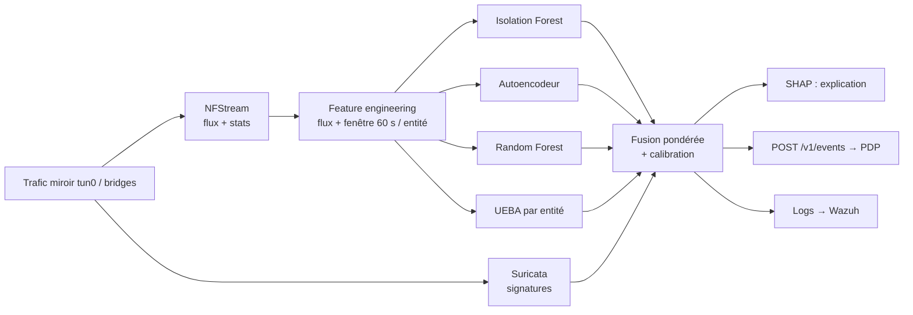

# 07 — Détection intelligente des anomalies réseau par IA

## 1. Objectifs

- Détecter **attaques connues** (supervisé) et **comportements inconnus** (non supervisé).
- Analyser à deux niveaux : **flux individuels** et **comportement par entité** (UEBA, fenêtre glissante).
- Produire un **score continu ∈ [0,1]** explicable, consommé par le PDP.
- Mesurer rigoureusement : métriques, latence, robustesse, dérive.

## 2. Pipeline



## 3. Données

| Source | Usage | Remarque |
|---|---|---|
| **CIC-IDS2017 / CSE-CIC-IDS2018** | Pré-entraînement, benchmark | Flux étiquetés (DoS, PortScan, Brute force, Botnet…) |
| **UNSW-NB15** | Benchmark complémentaire | 9 familles d'attaques |
| **Trafic du lab (propre)** | Entraînement final + test | **Indispensable** : évite le décalage de distribution |
| Trafic bénin généré | Navigation, API, SSH, transferts | Scripts `tests/traffic_benign.py` |
| Trafic malveillant généré | nmap, hydra, hping3, tunnel DNS, exfil | Étiqueté par horodatage et IP |

> **Point critique** : les modèles entraînés uniquement sur CIC-IDS2017 se généralisent mal à un autre réseau (*domain shift*). Le projet entraîne/affine sur **trafic réel du lab** et **mesure l'écart** (résultat scientifique à présenter).

### Protocole de collecte
1. Capturer 3–5 jours (ou sessions simulées) de trafic bénin multi-profils.
2. Rejouer/lancer les attaques par fenêtres horodatées → étiquettes.
3. Sauvegarder `pcap` + `flows.parquet` + `labels.csv`.
4. Découper **par temps** (train < val < test), jamais aléatoirement (évite la fuite temporelle).

## 4. Extraction des features

### 4.1 Niveau flux (NFStream)
```python
from nfstream import NFStreamer
import pandas as pd

# Temps réel
streamer = NFStreamer(source="tun0", statistical_analysis=True,
                      idle_timeout=15, active_timeout=60)
for flow in streamer:
    handle(flow)                      # → features → modèles

# Hors-ligne depuis un pcap
df = NFStreamer(source="capture.pcap", statistical_analysis=True).to_pandas()
```

| Catégorie | Features |
|---|---|
| Volume | `bidirectional_packets`, `bidirectional_bytes`, `src2dst_bytes`, `dst2src_bytes` |
| Durée / rythme | `bidirectional_duration_ms`, `bidirectional_mean_piat_ms`, `bidirectional_stddev_piat_ms` |
| Taille paquets | `bidirectional_mean_ps`, `bidirectional_stddev_ps`, `bidirectional_max_ps` |
| Drapeaux TCP | `syn_packets`, `fin_packets`, `rst_packets`, `psh_packets` |
| Protocole | `protocol`, `dst_port` (catégorisé), `application_name` |
| Dérivées | ratio `src2dst/dst2src`, octets par paquet, paquets par seconde |

### 4.2 Niveau comportement (UEBA) — fenêtre 60 s par IP/identité
| Feature | Intérêt |
|---|---|
| `n_flows` | Volume d'activité |
| `n_unique_dst_ip`, `n_unique_dst_port` | Scan horizontal/vertical |
| `dst_port_entropy` | Dispersion des ports |
| `failed_ratio` (RST / flux courts) | Brute force, scan |
| `bytes_out / bytes_in` | Exfiltration |
| `new_dst_ratio` | Destinations jamais vues pour cette identité |
| `hour_of_day` / écart au profil | Comportement hors habitudes |
| `dns_query_len_mean`, `dns_entropy` | Tunnel DNS |

```python
import numpy as np, pandas as pd
from scipy.stats import entropy

def window_features(g: pd.DataFrame) -> pd.Series:
    ports = g["dst_port"].value_counts(normalize=True)
    return pd.Series({
        "n_flows": len(g),
        "n_unique_dst_ip": g["dst_ip"].nunique(),
        "n_unique_dst_port": g["dst_port"].nunique(),
        "dst_port_entropy": entropy(ports, base=2),
        "bytes_ratio": g["src2dst_bytes"].sum() / (g["dst2src_bytes"].sum() + 1),
        "rst_ratio": (g["rst_packets"] > 0).mean(),
    })

# flows['window'] = flows['bidirectional_first_seen_ms'] // 60000
# ueba = flows.groupby(['src_ip', 'window']).apply(window_features)
```

## 5. Modèles

| Modèle | Type | Rôle | Forces | Limites |
|---|---|---|---|---|
| **Isolation Forest** | Non supervisé | Anomalies inconnues | Rapide, peu de réglages | Sensible à la contamination |
| **Autoencodeur** | Non supervisé (benign only) | Écart de reconstruction | Capture des corrélations | Seuil à calibrer |
| **Random Forest** | Supervisé | Attaques connues (classification) | Précis, explicable | Ne voit pas l'inconnu |
| **UEBA (IF sur fenêtres)** | Non supervisé | Comportement d'entité | Détecte scan, exfil lente | Besoin d'historique |
| *(bonus)* LSTM / Transformer | Séquentiel | Séquences de flux | Dépendances temporelles | Coûteux |
| *(bonus)* XGBoost / LightGBM | Supervisé | Comparatif | Très bon sur tabulaire | — |

### Entraînement baseline — `ai/train.py`
```python
import joblib, numpy as np, pandas as pd
from sklearn.ensemble import IsolationForest, RandomForestClassifier
from sklearn.preprocessing import RobustScaler
from sklearn.metrics import classification_report, roc_auc_score, precision_recall_curve

FEATURES = ["bidirectional_packets", "bidirectional_bytes", "bidirectional_duration_ms",
            "bidirectional_mean_ps", "bidirectional_stddev_ps",
            "bidirectional_mean_piat_ms", "syn_packets", "rst_packets",
            "src2dst_bytes", "dst2src_bytes"]

train = pd.read_parquet("data/train.parquet")
val   = pd.read_parquet("data/val.parquet")
test  = pd.read_parquet("data/test.parquet")      # split temporel

scaler = RobustScaler().fit(train[FEATURES])
Xtr, Xva, Xte = (scaler.transform(d[FEATURES]) for d in (train, val, test))

# 1) Non supervisé : entraîné sur le trafic bénin seulement
benign = Xtr[train["label"] == 0]
iforest = IsolationForest(n_estimators=300, contamination="auto",
                          random_state=42, n_jobs=-1).fit(benign)

# 2) Supervisé
rf = RandomForestClassifier(n_estimators=400, class_weight="balanced_subsample",
                            n_jobs=-1, random_state=42).fit(Xtr, train["label"])

# Évaluation
s_if = -iforest.score_samples(Xte)                 # plus grand = plus anormal
print("IF  AUC :", roc_auc_score(test["label"], s_if))
print(classification_report(test["label"], rf.predict(Xte), digits=4))

joblib.dump({"scaler": scaler, "iforest": iforest, "rf": rf, "features": FEATURES},
            "models/baseline.joblib")
```

### Autoencodeur (PyTorch) — `ai/autoencoder.py`
```python
import torch, torch.nn as nn

class AE(nn.Module):
    def __init__(self, d, h=(32, 16, 8)):
        super().__init__()
        self.enc = nn.Sequential(nn.Linear(d, h[0]), nn.ReLU(),
                                 nn.Linear(h[0], h[1]), nn.ReLU(),
                                 nn.Linear(h[1], h[2]))
        self.dec = nn.Sequential(nn.Linear(h[2], h[1]), nn.ReLU(),
                                 nn.Linear(h[1], h[0]), nn.ReLU(),
                                 nn.Linear(h[0], d))
    def forward(self, x): return self.dec(self.enc(x))

def train_ae(Xbenign, epochs=60, lr=1e-3, bs=512):
    X = torch.tensor(Xbenign, dtype=torch.float32)
    m, opt, loss_fn = AE(X.shape[1]), None, nn.MSELoss()
    opt = torch.optim.Adam(m.parameters(), lr=lr)
    for ep in range(epochs):
        perm = torch.randperm(len(X))
        for i in range(0, len(X), bs):
            b = X[perm[i:i+bs]]
            opt.zero_grad(); loss = loss_fn(m(b), b); loss.backward(); opt.step()
    return m

def recon_error(m, X):
    X = torch.tensor(X, dtype=torch.float32)
    with torch.no_grad():
        return ((m(X) - X) ** 2).mean(dim=1).numpy()

# Seuil = percentile 99,5 de l'erreur sur validation bénigne
# thr = np.percentile(recon_error(m, X_val_benign), 99.5)
```

## 6. Fusion et calibration du score

Chaque modèle est converti en score ∈ [0,1], puis fusionné.

```python
import numpy as np

def norm_if(raw, lo, hi):        # lo/hi = percentiles 1 / 99.9 du bénin validation
    return float(np.clip((raw - lo) / (hi - lo), 0, 1))

def norm_ae(err, thr):           # thr = percentile 99,5
    return float(np.clip(err / (2 * thr), 0, 1))

W = {"iforest": 0.25, "ae": 0.25, "rf": 0.30, "ueba": 0.20}

def fuse(s: dict, suricata_critical: bool) -> float:
    a = sum(W[k] * s[k] for k in W)
    return 1.0 if suricata_critical else float(np.clip(a, 0, 1))
```
Les poids sont optimisés sur le jeu de validation (grille ou régression logistique de stacking). Calibration finale par **Platt / isotonic** pour que 0,8 ≈ 80 % de probabilité d'attaque.

## 7. Explicabilité

```python
import shap
explainer = shap.TreeExplainer(rf)
sv = shap.TreeExplainer(rf).shap_values(X_flow)
# top-3 features → champ "detail.top_features" envoyé au PDP et au SIEM
```
Intérêt : justifier une quarantaine (« 1 800 ports distincts en 60 s ») — exigence d'auditabilité d'une décision automatique.

## 8. Service d'inférence — `ai/serve.py`

```python
import json, time, joblib, httpx, numpy as np
from nfstream import NFStreamer

M = joblib.load("models/baseline.joblib")
PDP = "https://10.10.99.10:8443/v1/events"
THRESH_SEND = 0.3                         # n'envoie que si anormal ou périodique

def vpn_ip_to_cn(ip: str) -> str | None:  # lookup Redis/PDP
    ...

def score_flow(flow) -> float:
    x = np.array([[getattr(flow, f) for f in M["features"]]])
    x = M["scaler"].transform(x)
    s_if = norm_if(-M["iforest"].score_samples(x)[0], LO, HI)
    p_rf = float(M["rf"].predict_proba(x)[0, 1])
    return 0.5 * s_if + 0.5 * p_rf

for flow in NFStreamer(source="tun0", statistical_analysis=True, idle_timeout=10):
    cn = vpn_ip_to_cn(flow.src_ip)
    if not cn: continue
    s = score_flow(flow)
    if s >= THRESH_SEND:
        httpx.post(PDP, json={"cn": cn, "anomaly": s, "source": "ai",
                              "detail": {"dst": flow.dst_ip, "port": flow.dst_port}},
                   cert=("/certs/ai.crt", "/certs/ai.key"), verify="/certs/ca-chain.crt")
```

## 9. Évaluation

### Métriques
| Métrique | Définition | Cible |
|---|---|---|
| Precision / Recall / **F1** | Qualité de classification | F1 ≥ 0,95 |
| **ROC-AUC / PR-AUC** | Séparation, classes déséquilibrées | AUC ≥ 0,98 |
| **FPR** | Faux positifs sur trafic bénin | ≤ 2 % |
| **TTD** | Délai de détection (début attaque → score > seuil) | ≤ 10 s |
| **TTQ** | Délai jusqu'à quarantaine effective | ≤ 15 s |
| Latence d'inférence | ms par flux | < 50 ms |
| Débit | flux / seconde supportés | ≥ 1 000 |

### Expériences à mener (chapitre résultats)
| Exp. | Question | Méthode |
|---|---|---|
| E1 | Quel modèle est le meilleur ? | Comparaison IF / AE / RF / XGB / fusion |
| E2 | Le modèle généralise-t-il ? | Entraîner CIC-IDS2017 → tester sur lab (domain shift) |
| E3 | Gain de l'UEBA ? | Avec / sans features de fenêtre |
| E4 | Apport de l'IA au Zero Trust ? | Politique statique vs dynamique : TTQ, volume de données exfiltré |
| E5 | Robustesse | Attaque lente (low-and-slow), bruit, évasion simple |
| E6 | Dérive | Changement de profil bénin → réentraînement planifié |
| E7 | Ablation de features | Importance SHAP, retrait par groupe |

## 10. Dérive, mise à jour et sécurité du ML

- **Surveillance de dérive** : PSI / KS-test sur les distributions de features, alerte si > seuil.
- **Réentraînement** hebdomadaire sur trafic validé bénin ; **versionnage** (`models/v1.2.joblib` + hash SHA-256).
- **Empoisonnement** : l'entraînement n'utilise que des périodes validées ; ne jamais réentraîner automatiquement sur du trafic déjà classé « normal » par le modèle.
- **Évasion** : combinaison signatures + ML + règles d'entité ; tests d'attaques lentes.
- Protection des modèles : fichiers en lecture seule, signature, accès restreint.

## 11. Limites assumées (à discuter dans le rapport)

- Trafic de lab ≠ production (taille, diversité).
- Détection sur trafic **chiffré** : on analyse métadonnées de flux, pas le contenu (avantage : respect de la vie privée, limite : moins de signal).
- Faux positifs → impact sur la disponibilité : d'où paliers progressifs (réduction avant quarantaine) et TTL.
- Étiquetage réalisé par l'équipe : biais possible.
