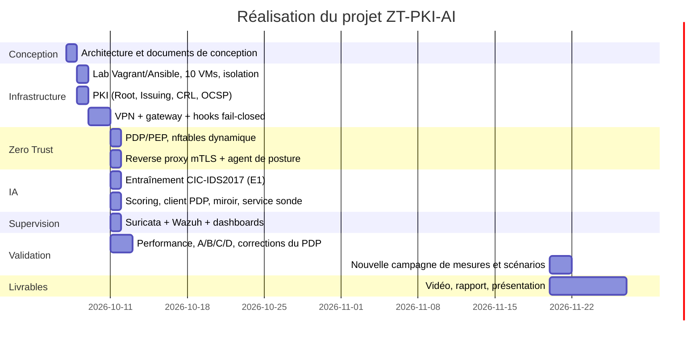

# 10 — Planning, livrables et soutenance

> Déroulement réel du projet, reconstitué à partir de l'historique Git. Le dépôt est un monorepo partagé par l'équipe de deux étudiants.

## 1. Roadmap

## 2. Jalons (milestones)

| Jalon | Contenu | Statut | Preuve |
|---|---|---|---|
| **M1** | Lab opérationnel + PKI complète | fait | `openssl verify`, révocation démontrée |
| **M2** | VPN mTLS + hooks + fail-closed | fait | S1–S6, S9, S10 (`tests/run-m2.sh`) |
| **M3** | PDP + nftables dynamique | fait | Droits par rôle et TTL, S7 |
| **M4** | Modèles IA entraînés localement | fait | E1 : [`ai/reports/metrics.md`](../ai/reports/metrics.md) |
| **M5** | Boucle fermée IA → PDP → PEP | fait | Alerte critique simulée → règle retirée en 0,36 à 0,43 s |
| **M6** | SIEM + dashboards | fait | Règles de corrélation, FIM (S11), `siem/dashboards/` |
| **M7** | Évaluation comparative A/B/C/D | fait | [`tests/reports/results.md`](../tests/reports/results.md), [`perf.md`](../tests/reports/perf.md), graphiques |
| **M8** | Rapport, présentation, vidéo de démonstration | vidéo faite ; rapport et présentation en finalisation | voir §3 |

## 3. Livrables

| Livrable | Description |
|---|---|
| Dépôt GitHub | Code, infrastructure as code, scripts de test, preuves, documentation (`docs/`) |
| Rapport | Rédigé sur LambdaTeX (plan au §4) |
| Présentation | Support de soutenance |
| Vidéo de démonstration | 4 min 16 s, en français, à partir d'enregistrements d'écran réels du lab : déploiement, scénarios, comparaison A/B/C/D |

## 4. Plan du rapport

1. **Analyse** : contexte, problématique, modèle de menaces, exigences.
2. **Conception** : architecture Zero Trust (PKI, VPN, PDP/PEP, sonde IA, SIEM), plan d'adressage, choix techniques.
3. **Tutoriel** : déploiement du lab de zéro (`cd infra && make core detection workloads client`), émission des certificats, connexion d'un client, exécution des scénarios et des mesures.
4. **Outils** : rôle et configuration de chaque outil (OpenSSL, OpenVPN, OPA, nftables, NFStream, scikit-learn/PyTorch, Suricata, Wazuh, Vagrant/Ansible), avec les résultats obtenus.

## 5. Démonstration

La démonstration est la vidéo enregistrée sur le lab réel. Pendant la soutenance, elle peut être complétée en direct par `make scenarios` ou par un scénario isolé (`tests/run-redteam.sh s8`), et par les vues Wazuh depuis l'hôte (10.10.99.2).

## 6. Difficultés rencontrées

| Difficulté | Solution retenue |
|---|---|
| Pas de passthrough CUDA dans VirtualBox | Entraînement sur le GPU de l'hôte, inférence CPU sur `zt-sensor` |
| Pas de port mirroring dans VirtualBox | Copie logicielle `tc mirred` sur `zt-gw` ; coût mesuré (≈ 54 % du débit) |
| VirtualBox 7.0 dupliquait les trames sur les réseaux internes (resets TCP entre zones) | Passage à VirtualBox 7.1 et cartes virtio sur toutes les VMs |
| Les VMs joignaient la zone mgmt par l'interface NAT de Vagrant, en contournant la gateway | Route `unreachable 10.10.0.0/16` sur chaque VM (`infra/ansible/tasks/routes.yml`) |
| Wazuh rejetait les événements `eve.json` | `analysisd.decoder_order_size=1024` |
| Écarts du PDP trouvés pendant l'évaluation (F1–F6) | Corrigés et re-testés ([`perf.md` §5](../tests/reports/perf.md)) |

## 7. Bonnes pratiques appliquées

- Un `README` par dossier, une fiche par scénario.
- Aucun secret dans le dépôt : clés, matériel PKI, profils `.ovpn`, identité mTLS du moteur IA et modèles entraînés sont exclus par `.gitignore` (seul `manifest.json` est versionné).
- Une preuve (log, capture) dans `tests/evidence/` pour chaque résultat annoncé.
- Reproductibilité : déploiement par étapes avec les cibles de `infra/Makefile` (`core`, `detection`, `workloads`, `client`, `vpn`, `scenarios`, `abcd`, `perf`).

## 8. Glossaire

| Terme | Définition |
|---|---|
| **ZTA** | Zero Trust Architecture |
| **PDP / PEP** | Point de décision / d'application de la politique |
| **mTLS** | Authentification mutuelle TLS par certificats |
| **CRL / OCSP** | Liste / protocole de statut de révocation |
| **FPR** | Taux de faux positifs |
| **FIM** | Surveillance d'intégrité de fichiers |
| **TTL** | Durée de validité d'une règle d'accès accordée par le PDP |
