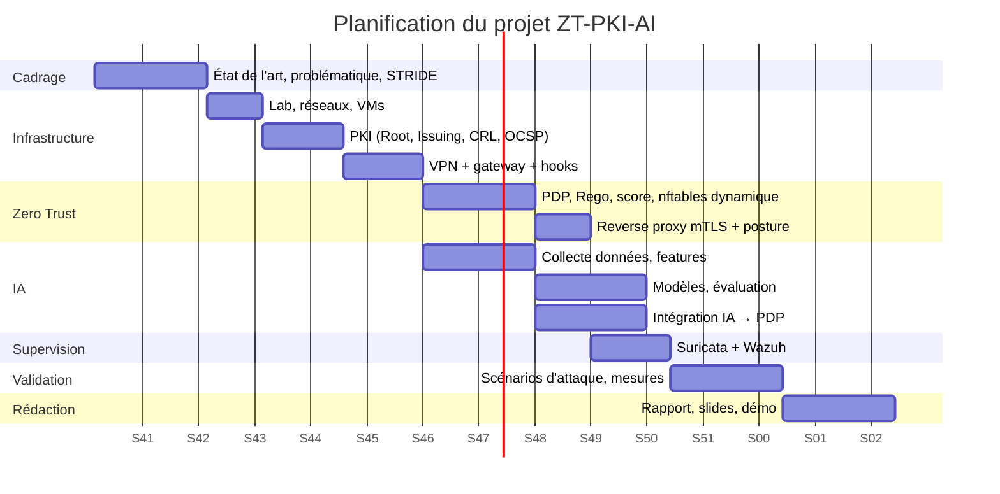

# 10 — Planning, livrables et soutenance

> Planning type sur **14 semaines** (à adapter à la durée réelle du projet).

## 1. Roadmap

## 2. Jalons (milestones)

| Jalon | Contenu | Preuve |
|---|---|---|
| **M1** | Lab opérationnel + PKI complète | `openssl verify`, révocation démontrée |
| **M2** | VPN mTLS + hooks + fail-closed | Tests S1–S4, S13, S14 |
| **M3** | PDP + nftables dynamique | Droits par rôle, TTL |
| **M4** | Pipeline IA entraîné | Rapport de métriques (E1–E3) |
| **M5** | Boucle fermée IA → PDP → PEP | S8–S11 réussis, TTQ mesuré |
| **M6** | SIEM + dashboards | Captures, règles de corrélation |
| **M7** | Évaluation comparative A/B/C/D | Tableaux, graphiques |
| **M8** | Rapport + démo finale | Documents livrés |

## 3. Livrables

| Livrable | Description |
|---|---|
| Dépôt Git | Code, configs, scripts, docs (ce dossier) |
| Rapport technique | 60–90 pages (plan ci-dessous) |
| Notebooks IA | EDA, entraînement, évaluation, SHAP |
| Dossier de tests | Fiches S1–S17 + résultats + preuves |
| Dashboards Wazuh | Export des tableaux de bord |
| Présentation | 20–25 slides |
| **Démo vidéo + live** | Scénario de 10 min |
| Manuel de déploiement | Reproduire le lab de zéro |

## 4. Plan du rapport

1. **Introduction** : contexte, problématique, objectifs, méthodologie
2. **État de l'art** : Zero Trust (NIST 800-207), PKI, VPN, IDS, ML pour la détection d'intrusion, travaux liés
3. **Analyse et conception** : exigences, modèle de menaces, architecture, ADR
4. **Réalisation** : PKI, VPN, PDP/PEP, pipeline IA, SIEM
5. **Évaluation** : protocole, scénarios, métriques, comparaison A/B/C/D, performances
6. **Discussion** : limites, domain shift, faux positifs, éthique, vie privée
7. **Conclusion et perspectives**
8. **Annexes** : configs, code clé, fiches de test, glossaire

## 5. Scénario de démonstration (10 min)

| Min | Action | Message clé |
|---|---|---|
| 0–1 | Architecture en une slide | Zero Trust : jamais de confiance implicite |
| 1–2 | Connexion sans cert → refus | Identité forte |
| 2–3 | Connexion légitime → accès proxy seulement | Moindre privilège |
| 3–4 | Tentative SSH hors rôle → drop | Micro-segmentation |
| 4–6 | **Scan depuis client compromis** → score ↓ → quarantaine (dashboard live) | **IA dans la boucle** |
| 6–7 | Révocation du certificat → reconnexion refusée | Cycle de vie PKI |
| 7–8 | Dashboard Wazuh + explication SHAP | Auditabilité |
| 8–9 | Chiffres : TTQ, F1, FPR, overhead | Évaluation rigoureuse |
| 9–10 | Limites + perspectives | Esprit critique |

## 6. Risques et plans de réponse

| Risque | Proba. | Impact | Mitigation |
|---|---|---|---|
| Ressources matérielles insuffisantes | Moyenne | Élevé | Profil léger, conteneurs |
| Complexité d'intégration (hooks, nft) | Élevée | Moyen | Intégration incrémentale, tests dès M2 |
| Mauvaise performance IA sur lab | Moyenne | Élevé | Collecte propre, fine-tuning, features UEBA |
| Faux positifs excessifs | Moyenne | Moyen | Paliers progressifs, TTL, seuils calibrés |
| Dépassement de planning | Moyenne | Moyen | MVP défini (M1–M5), bonus optionnels |
| Perte de VM | Faible | Élevé | Snapshots, IaC, Git |

## 7. Périmètre minimal (MVP) vs extensions

### MVP (indispensable)
- PKI 2 niveaux + CRL
- OpenVPN mTLS + hooks + fail-closed
- PDP avec règles nftables dynamiques et TTL
- Pipeline IA (IF + RF + features UEBA) intégré au PDP
- Suricata + Wazuh de base
- Scénarios S1–S4, S7–S10 et mesures TTQ/F1/FPR

### Extensions (points bonus)
- step-ca / ACME, certificats de 24 h
- Clés protégées par **TPM / HSM (PKCS#11)**
- Autoencodeur + LSTM, XGBoost, stacking
- Comparatif WireGuard
- Accès applicatif avec OIDC (Keycloak) + MFA
- SOAR (TheHive/Cortex ou n8n) pour la réponse
- Évaluation de **robustesse adversariale** (évasion/empoisonnement)
- Déploiement via **Ansible** / **Terraform** + CI (GitHub Actions)
- Fédération/apprentissage continu avec contrôle de dérive

## 8. Bonnes pratiques de projet

- Git : branches par composant, commits signés, `README` par dossier.
- Aucun secret dans le dépôt (`.gitignore` : `*.key`, `*.pem`, `.env`).
- Journal de bord hebdomadaire (décisions, problèmes, mesures).
- Une **capture ou un log** comme preuve pour chaque résultat annoncé.
- Reproductibilité : `make all` doit reconstruire l'essentiel.

## 9. Glossaire

| Terme | Définition |
|---|---|
| **ZTA** | Zero Trust Architecture |
| **PDP / PEP** | Point de décision / d'application de la politique |
| **mTLS** | Authentification mutuelle TLS par certificats |
| **CRL / OCSP** | Listes / protocole de statut de révocation |
| **UEBA** | Analyse comportementale des utilisateurs et entités |
| **TTD / TTQ** | Temps de détection / de mise en quarantaine |
| **FPR** | Taux de faux positifs |
| **FIM** | Surveillance d'intégrité de fichiers |
| **Domain shift** | Différence de distribution entre données d'entraînement et de production |
