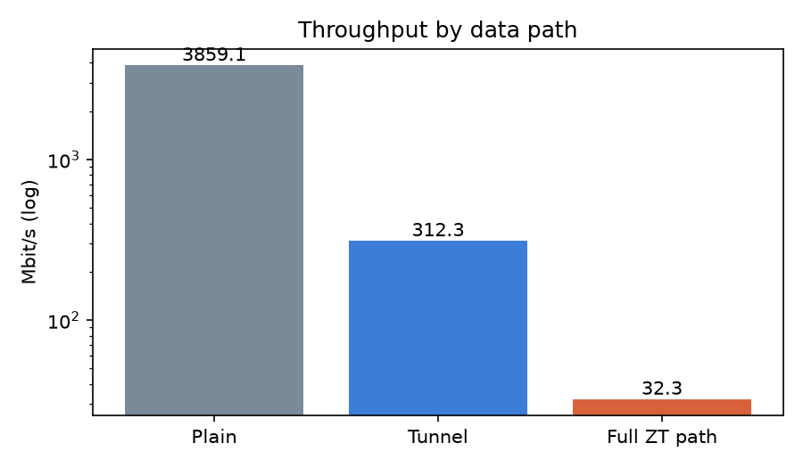

# Phase 10 — measured results

Generated by `tests/reports/make_report.py` from the JSON files in this directory. Analysis: [perf.md](perf.md).

## Performance (ENF2, H4)

| Path | Throughput (Mbit/s) | RTT (ms) |
|---|---:|---:|
| Plain (client → gateway, no tunnel) | 3913.8 | 0.318 |
| OpenVPN tunnel (client → gateway) | 273.5 | 0.678 |
| Full ZT path (tunnel → nftables → web-app) | 33.2 | – |

| Metric | Measured | Target | Status |
|---|---:|---:|---|
| PDP decision (authenticate, median) | 19.1 ms | ≤ 500 ms | met |
| OpenVPN connect (handshake + hooks + PDP) | 1.28 s | – | – |
| Gateway CPU during full-ZT run | 38.76 % | – | – |

Same forwarded path in every configuration (client-lin tun0 -> zt-gw (nftables) -> web-app 10.10.20.10:5201):

| Configuration | Throughput (Mbit/s) | Overhead vs A | Gateway CPU |
|---|---:|---:|---:|
| A – Perimeter VPN | 35.5 | baseline | 43.22 % |
| B – Static ZT | 33.1 | 6.8 % | 45.57 % |
| C – Dynamic PDP | 33.3 | 6.2 % | 41.05 % |
| D – PDP + AI (full) | 37.1 | -4.5 % | 44.88 % |
| D_no_mirror – D without traffic mirror | 93.7 | mirror costs D 60.4 % | 45.13 % |

Target: ZT overhead ≤ 15 %. Worst configuration: 6.8 % → **met**.

## A/B/C/D comparison — exposed surface (benign probe)

One TCP connect / HTTPS request per service from alice's tunnel (employee role). `open` = the gateway let it through.

| Target | ZT expects | A – Perimeter VPN | B – Static ZT | C – Dynamic PDP | D – PDP + AI (full) |
|---|---|---|---|---|---|
| `proxy_https_mtls` (10.10.10.10:443) | allow | open | open | open | open |
| `app_direct_8080` (10.10.20.10:8080) | deny | **open** ⚠ | blocked | blocked | blocked |
| `app_ssh_admin_only` (10.10.20.10:22) | deny | **open** ⚠ | blocked | blocked | blocked |
| `db_5432` (10.10.30.10:5432) | deny | **open** ⚠ | blocked | blocked | blocked |
| `pki_subca_ssh` (10.10.99.5:22) | deny | **open** ⚠ | blocked | blocked | blocked |
| `siem_dashboard` (10.10.99.20:443) | deny | **open** ⚠ | blocked | blocked | blocked |
| `pdp_posture_channel` (10.10.99.10:8443) | allow | open | open | open | open |
| **Reachable services** | | 7/7 | 2/7 | 2/7 | 2/7 |
| **ZT violations** | | 5 | 0 | 0 | 0 |
| **Rights expire (TTL)** | | no (permanent) | no (permanent) | yes | yes |

Run `bash tests/abcd/attack-abcd.sh` to populate the comparative attack columns (S7, S8/S10, S12) from `client-lin`.

## Charts

