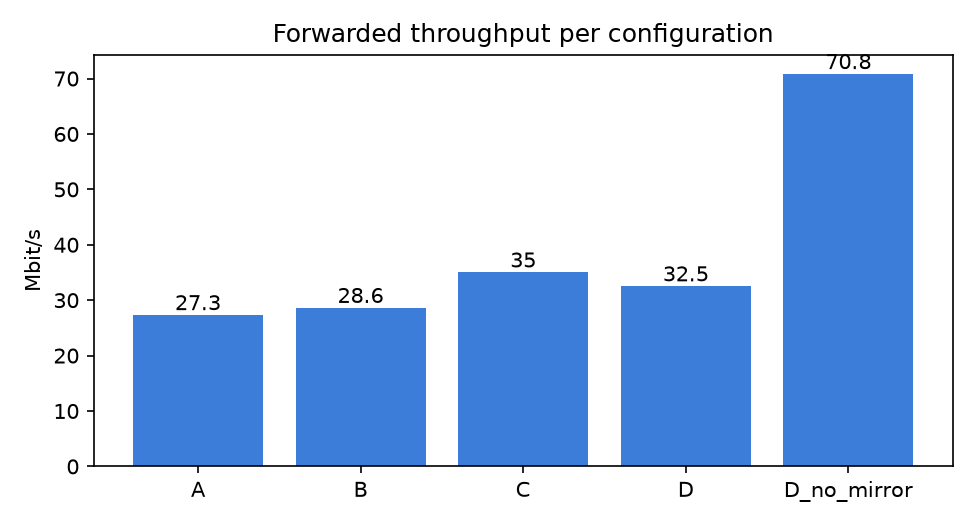
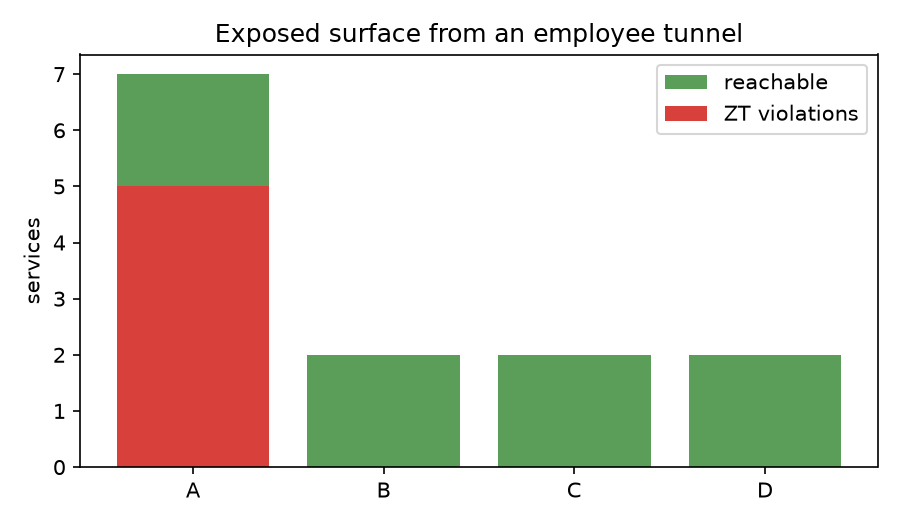

# Phase 10 — measured results

Generated by `tests/reports/make_report.py` from the JSON files in this directory. Analysis: [perf.md](perf.md).

## Performance (ENF2, H4)

| Path | Throughput (Mbit/s) | RTT (ms) |
|---|---:|---:|
| Plain (client → gateway, no tunnel) | 3859.1 | 0.424 |
| OpenVPN tunnel (client → gateway) | 312.3 | 0.841 |
| Full ZT path (tunnel → nftables → web-app) | 32.3 | – |

| Metric | Measured | Target | Status |
|---|---:|---:|---|
| PDP decision (authenticate, median) | 20.8 ms | ≤ 500 ms | met |
| OpenVPN connect (handshake + hooks + PDP) | 1.28 s | – | – |
| Gateway CPU during full-ZT run | 40.3 % | – | – |

Same forwarded path in every configuration (client-lin tun0 -> zt-gw (nftables) -> web-app 10.10.20.10:5201):

| Configuration | Throughput (Mbit/s) | Overhead vs A | Gateway CPU |
|---|---:|---:|---:|
| A – Perimeter VPN | 27.3 | baseline | 39.94 % |
| B – Static ZT | 28.6 | -4.8 % | 41.47 % |
| C – Dynamic PDP | 35.0 | -28.2 % | 42.87 % |
| D – PDP + AI (full) | 32.5 | -19.0 % | 45.57 % |
| D_no_mirror – D without traffic mirror | 70.8 | mirror costs D 54.1 % | 40.24 % |

Target: ZT overhead ≤ 15 %. Worst configuration: -4.8 % → **met**.

## A/B/C/D comparison — exposed surface (benign probe)

One TCP connect / HTTPS request per service from alice's tunnel (employee role). `open` = the gateway let it through.

| Target | ZT expects | A – Perimeter VPN | B – Static ZT | C – Dynamic PDP | D – PDP + AI (full) |
|---|---|---|---|---|---|
| `proxy_https_mtls` (10.10.10.10:443) | allow | open | open | open | open |
| `app_direct_8080` (10.10.20.10:8080) | deny | **open** ⚠ | blocked | blocked | blocked |
| `app_ssh_admin_only` (10.10.20.10:22) | deny | **open** ⚠ | blocked | blocked | blocked |
| `db_5432` (10.10.30.10:5432) | deny | **open** ⚠ | blocked | blocked | blocked |
| `pki_subca_ssh` (10.10.99.5:22) | deny | **open** ⚠ | blocked | blocked | blocked |
| `siem_dashboard` (10.10.99.20:443) | deny | **open** ⚠ | blocked | blocked | blocked |
| `pdp_posture_channel` (10.10.99.10:8443) | allow | open | open | open | open |
| **Reachable services** | | 7/7 | 2/7 | 2/7 | 2/7 |
| **ZT violations** | | 5 | 0 | 0 | 0 |
| **Rights expire (TTL)** | | no (permanent) | no (permanent) | yes | yes |

## A/B/C/D comparison — attacks played from `client-lin`

| Attack Scenario (from `client-lin` / `10.8.0.10`) | A – Perimeter VPN | B – Static ZT | C – Dynamic PDP | D – PDP + AI (full) |
|---|---|---|---|---|
| **S7** — Out-of-role SSH (`10.10.20.10:22`) | EXPOSED | BLOCKED | BLOCKED | BLOCKED |
| **S8** — Stolen cert on unmanaged device (posture fail) | ALLOWED (proxy HTTP 200, no posture effect) | ALLOWED (proxy HTTP 200, no posture effect) | QUARANTINED (proxy HTTP 000) | QUARANTINED (proxy HTTP 000) |

## Charts

